```mermaid
%%{init: {'theme':'base','themeVariables':{'fontSize':'16px','lineColor':'#4B5563'}}}%%
flowchart LR
    A["`**Imagine de intrare**
fotografie aeriana din VisDrone, cu multe obiecte mici si conditii variate de lumina`"]
    B["`**Analiza statistica**
masoara luminozitatea, contrastul si zgomotul din histograma; incadreaza imaginea intr-o grupa (intuneric, contrast slab, normal)`"]
    C["`**Imbunatatirea contrastului**
CLAHE pe canalul de luminanta, ca sa nu altereze culorile; uniform pe toate imaginile sau adaptiv, doar pe grupele care il cer`"]
    D["`**Feliere pe grila fixa (sau SAHI)**
ferestre suprapuse pe toata imaginea, ca fiecare obiect sa apara intreg macar intr-una; plus imaginea intreaga, micsorata, pentru obiectele mari`"]
    K["`**Detectie preliminara**
YOLO pe imaginea micsorata arata rapid unde sunt obiecte; inspirat din QueryDet`"]
    L["`**Ferestre adaptive**
detectiile devin o masca, dilatata ca obiectele apropiate sa se uneasca; fiecare componenta conexa devine o fereastra; inspirat din ClusDet`"]
    E["`**Detectie pe ferestre**
YOLO pe fiecare fereastra; chenarele gasite sunt mutate in coordonatele imaginii intregi`"]
    F["`**Antrenarea modelului**
fine-tuning YOLO26n pe train, pe imagini intregi sau pe felii, cu aceeasi imbunatatire a contrastului ca la test; parametri alesi pe val`"]
    G["`**Fuziunea detectiilor**
elimina obiectele taiate la marginea ferestrelor si pastreaza un singur chenar acolo unde ferestrele suprapuse au gasit acelasi obiect`"]
    H["`**Detectii finale**
chenar, clasa (pieton, masina etc.) si scor de incredere pentru fiecare obiect`"]
    I["`**Evaluare**
mAP fata de etichetele facute de oameni, pe tot setul si pe fiecare grupa; timp pe imagine`"]
    J["`**Tabel de rezultate**
o linie pentru fiecare varianta testata, comparata cu baseline-ul`"]

    A --> B --> C --> D --> E
    F --> E
    E --> G --> H --> I --> J
    B --> I
    C --> K --> L --> E

    LEG["⬜ intrare &nbsp; 🟦 prelucrarea imaginii &nbsp; 🟩 antrenare si detectie &nbsp; 🟨 evaluare"]
    J ~~~ LEG

    classDef inp fill:#F3F4F6,stroke:#374151,stroke-width:2px,color:#111827
    classDef prep fill:#DBEAFE,stroke:#1D4ED8,stroke-width:2px,color:#111827
    classDef det fill:#DCFCE7,stroke:#15803D,stroke-width:2px,color:#111827
    classDef eva fill:#FEF3C7,stroke:#B45309,stroke-width:2px,color:#111827
    classDef leg fill:#FFFFFF,stroke:#D1D5DB,stroke-width:1px,color:#374151,font-size:12px

    class A inp
    class B,C,D,K,L prep
    class E,F,G det
    class H,I,J eva
    class LEG leg
```

Drumul de sus (feliere pe grila) si cel de jos (detectie preliminara si ferestre adaptive) sunt doua feluri de a alege ferestrele; se folosesc separat sau impreuna (`pi-eval --mode slice`, `sahi` sau `adaptive`).

Fiecare caseta din schema este explicata pas cu pas in [pipeline/README.md](pipeline/README.md).
