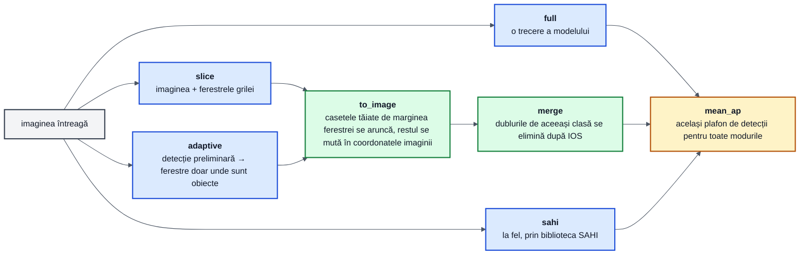
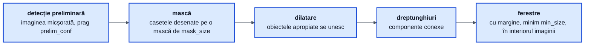

# Pipeline-ul proiectului

Documentul arată cum se leagă comenzile `pi-*` între ele: ce primește fiecare, ce produce și ce variantă din experimente acoperă. Motivația metodelor e în [Arhitectura_si_metodologie.md](Arhitectura_si_metodologie.md), iar ordinea experimentelor în [benchmarkuri.md](benchmarkuri.md).

## 1. De la date la rezultate


Fiecare pas scrie un set de date nou în `datasets/` și nu îl modifică pe cel de intrare, cu excepția lui `pi-prepare`, care convertește datele pe loc:

| Set de date | Produs de | Folosit pentru |
|---|---|---|
| `datasets/VisDrone` | `pi-prepare` | antrenarea pe imagini întregi și toate evaluările |
| `datasets/VisDrone-tiled` | `pi-tile` | antrenarea pe felii |
| `datasets/VisDrone-clahe` | `pi-clahe --mode uniform` | etapa 2, CLAHE pe toate imaginile |
| `datasets/VisDrone-clahe-adaptive` | `pi-clahe --mode adaptive` | etapa 2, CLAHE doar pe grupele `dark` și `low_contrast` |

## 2. Ce face `pi-eval` cu o imagine

Toate modurile primesc aceeași imagine întreagă și aceleași etichete, deci diferă doar felul în care se obțin detecțiile. Calculul mAP-ului e comun ([metrics.py](../src/pi_p/metrics.py)).



SAHI face aceiași pași în interiorul bibliotecii, cu propria fuziune (`GREEDYNMM` după IOS).

Ferestrele adaptive ([adaptive.py](../src/pi_p/adaptive.py)) se construiesc din detecțiile preliminare astfel:



Parametrii sunt în [configs/adaptive.yaml](../configs/adaptive.yaml) și se pot schimba din linia de comandă cu `key=value`.

## 3. Comenzile

| Comandă | Modul | Intrare | Ieșire | Opțiuni importante |
|---|---|---|---|---|
| `pi-prepare` | [prepare.py](../src/pi_p/prepare.py) | arhivele VisDrone (descărcate automat) | `datasets/VisDrone`, `data.yaml` | `--splits` |
| `pi-check` | [check.py](../src/pi_p/check.py) | setul de date | raport în consolă, cod 1 la erori | `--splits` |
| `pi-eda` | [eda.py](../src/pi_p/eda.py) | un split | `eda_out/summary.json` și grafice | `--imgsz 640 1024` |
| `pi-stats` | [stats.py](../src/pi_p/stats.py) | toate split-urile | `stats.csv`, `stats.png` | `--dark 70`, `--low-contrast 35` |
| `pi-clahe` | [enhance.py](../src/pi_p/enhance.py) | setul de date și `stats.csv` | set nou, cu imagini îmbunătățite | `--mode uniform\|adaptive`, `--clip`, `--grid` |
| `pi-tile` | [tile.py](../src/pi_p/tile.py) | setul de date | set nou, cu felii | `--size`, `--overlap`, `--min-visibility`, `--empty` |
| `pi-train` | [train.py](../src/pi_p/train.py) | un fișier din `configs/` | `runs/<name>/weights/best.pt` | `key=value` peste config |
| `pi-eval` | [evaluate.py](../src/pi_p/evaluate.py) | `best.pt` și setul de date | mAP în consolă, JSON cu `--out` | `--mode`, `--groups`, `--limit` |
| `pi-predict` | [predict.py](../src/pi_p/predict.py) | imagine, folder sau video | imagini cu detecțiile desenate | `--slice` |
| `python -m pi_p.adaptive_figure` | [adaptive_figure.py](../src/pi_p/adaptive_figure.py) | o imagine | figura cu pașii ferestrelor adaptive | `--comparison-out` |

Modurile din `pi-eval`:

| `--mode` | Ce rulează | Variantă din experimente |
|---|---|---|
| `val` | `model.val()` din Ultralytics, cu `--coco` pentru modelul preantrenat | verificare rapidă |
| `full` | o trecere pe imaginea întreagă | baseline |
| `slice` | imaginea întreagă și grila de ferestre, fuziune proprie | feliere pe grilă fixă |
| `sahi` | același lucru, prin biblioteca SAHI | SAHI |
| `adaptive` | detecție preliminară și ferestre adaptive | ferestre adaptive |

## 4. Rețeta experimentelor

Toate rulările de comparație se fac pe `val`, cu pragul implicit `--conf 0.001`, și salvează rezultatul în JSON:

```bash
uv run pi-stats
uv run pi-train configs/train.yaml
uv run pi-tile
uv run pi-train configs/train_tiled.yaml

G=datasets/VisDrone/stats.csv
uv run pi-eval runs/yolo26n_640/weights/best.pt   --mode full  --groups $G --out results/full.json
uv run pi-eval runs/yolo26n_640/weights/best.pt   --mode sahi  --groups $G --out results/sahi.json
uv run pi-eval runs/yolo26n_tiled/weights/best.pt --mode slice --groups $G --out results/slice.json
uv run pi-eval runs/yolo26n_640/weights/best.pt   --mode adaptive --groups $G --out results/adaptive.json
```

Pentru etapa 2 se rulează `pi-clahe --mode uniform` și `pi-clahe --mode adaptive`, apoi configurația câștigătoare din etapa 1 se reantrenează pe fiecare set nou (`pi-train <config> data=datasets/VisDrone-clahe/data.yaml name=...`) și se evaluează la fel, cu `--data` spre același set îmbunătățit, ca modelul să vadă la test aceleași imagini ca la antrenare.

`--limit 20` rulează doar primele 20 de imagini, util ca verificare înainte de rularea completă.
