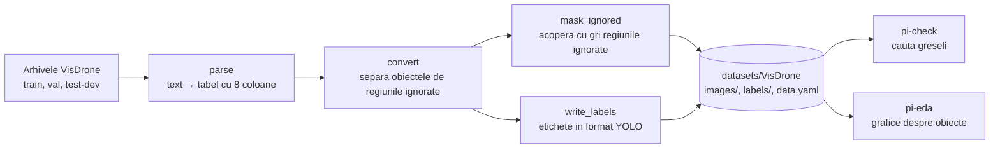

# 1. Pregatirea datelor

**Cod:** `src/pi_p/prepare.py`, `check.py`, `eda.py`, `data.py` · **Comenzi:** `pi-prepare`, `pi-check`, `pi-eda`

## De ce e nevoie de etapa asta

VisDrone vine in formatul lui propriu, iar Ultralytics YOLO citeste alt format. In plus, VisDrone are regiuni marcate ca „ignorate”: zone cu obiecte prea mici sau prea dese, pe care adnotatorii nu le-au etichetat unul cate unul. Daca le lasam in imagine, modelul vede acolo masini fara eticheta si invata ca „nu sunt obiecte”, iar la evaluare e penalizat daca le detecteaza.

## Schema



## Cele doua formate

O linie dintr-un fisier de adnotari VisDrone descrie un obiect:

```
x, y, latime, inaltime, scor, categorie, trunchiere, ocluzie
684, 8, 273, 116, 0, 0, 0, 0
406, 119, 265, 70, 1, 4, 0, 0
```

- `(x, y)` este coltul stanga-sus al chenarului, in pixeli;
- `scor` 0 inseamna „ignora acest chenar”;
- `categorie` 1–10 sunt clasele reale; 0 este „regiune ignorata”, 11 este „altele”.

Aceeasi masina (a doua linie), in format YOLO, intr-o imagine de 1360 × 765:

```
3 0.395956 0.201307 0.194853 0.091503
```

- prima valoare este clasa, numarata de la 0 (4 − 1 = 3, adica `car`);
- urmeaza centrul chenarului si dimensiunile lui, impartite la latimea si inaltimea imaginii.

Calculul pentru centrul pe orizontala: (406 + 265 / 2) / 1360 = 0.3960.

## Ce se intampla cu fiecare adnotare

Functia `convert` imparte liniile in trei categorii:

| Conditie | Ce devine |
|---|---|
| scor ≠ 0 si categorie intre 1 si 10 | obiect pastrat, scris in etichete |
| scor = 0, categorie 0 sau categorie 11 | regiune ignorata, acoperita cu gri |
| chenar cu arie zero dupa taierea la marginile imaginii | aruncat |

Functia `mask_ignored` vopseste regiunile ignorate cu gri (valoarea 114, aceeasi cu care YOLO completeaza marginile imaginii). Daca un obiect pastrat se afla intr-o regiune ignorata, pixelii lui raman vizibili.

## Verificarea si analiza

`pi-check` trece prin tot setul si raporteaza imagini corupte, imagini fara eticheta, clase inexistente, chenare cu arie zero sau in afara imaginii si linii duplicate. Se ruleaza si dupa feliere, pentru ca acolo se scriu etichete noi.

`pi-eda` face grafice despre date: cate obiecte are fiecare clasa, cate obiecte sunt pe imagine si, cel mai important, cat de mari sunt obiectele asa cum le vede modelul. O imagine de 1920 px micsorata la 640 px isi micsoreaza si obiectele de 3 ori, iar multe ajung sub 16 px. Acesta e motivul pentru felierea din etapa 4.

## Rezultatul

```
datasets/VisDrone/
    images/train/   6471 imagini
    images/val/      548 imagini
    images/test/    1610 imagini
    labels/...      cate un .txt pentru fiecare imagine
    annotations/... adnotarile originale, pastrate
    data.yaml       ce citeste Ultralytics
```

## Comenzi

```bash
uv run pi-prepare          # descarca (~2 GB) si converteste
uv run pi-check            # trebuie sa afiseze OK pentru train si val
uv run pi-eda              # scrie graficele in eda_out/
```
