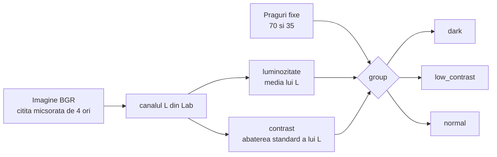

# 2. Analiza statistica a imaginilor

**Cod:** `src/pi_p/stats.py` · **Comanda:** `pi-stats`

## De ce e nevoie de etapa asta

VisDrone contine imagini de zi, de seara si de noapte. Vrem sa stim doua lucruri:

1. care imagini sunt intunecate sau au contrast slab, ca sa le putem imbunatati doar pe ele (CLAHE adaptiv, etapa 3);
2. daca o metoda ajuta in special imaginile grele, chiar cand media pe tot setul abia se misca (evaluarea pe grupe, etapa 8).

Pentru asta, fiecare imagine primeste o eticheta: `dark`, `low_contrast` sau `normal`.

## Schema



## Cei doi indicatori

Amandoi se calculeaza in `brightness_contrast`, pe **luminanta**: canalul L din spatiul de culoare Lab, care spune cat de luminos e fiecare pixel, fara culoare. Valorile sunt intre 0 (negru) si 255 (alb).

| Indicator | Cum se calculeaza | Ce inseamna |
|---|---|---|
| luminozitate | media lui L | mica = imagine intunecata |
| contrast | abaterea standard a lui L | mica = pixelii au valori apropiate, imagine „stearsa” |

Imaginea se citeste micsorata de 4 ori (`cv2.IMREAD_REDUCED_COLOR_4`). O medie si o abatere standard ies practic la fel si pe imaginea mica, iar citirea e mult mai rapida.

## Regula de incadrare

```
daca luminozitate < 70      → dark
altfel daca contrast < 35   → low_contrast
altfel                      → normal
```

Ordinea conteaza: o imagine intunecata are de obicei si contrast mic, iar noi vrem sa o numim `dark`.

Pragurile sunt constantele `DARK` si `LOW_CONTRAST` si se pot schimba cu `--dark` si `--low-contrast`. Daca le schimbi, trebuie refacut si setul CLAHE adaptiv, pentru ca el depinde de grupe. Incadrarea este o eticheta de analiza si nu schimba impartirea in train, val si test.

## Rezultatul

```
datasets/VisDrone/
    stats.csv    o linie pe imagine, din toate subseturile
    stats.png    histogramele luminozitatii si contrastului pe train, cu pragurile desenate
```

Tabelul arata asa:

```
split,image,brightness,contrast,group
train,0000002_00005_d_0000014.jpg,112.43,48.21,normal
```

Histogramele din `stats.png` arata unde cad pragurile fata de distributia reala a imaginilor.

## Comanda

```bash
uv run pi-stats            # toate subseturile, ~1 minut
```

Cate imagini intra in fiecare grupa este in [../rezultate.md](../rezultate.md).
