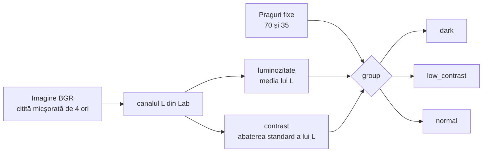

# 2. Analiza statistică a imaginilor

**Cod:** `src/pi_p/stats.py` · **Comandă:** `pi-stats`

## De ce e nevoie de etapa asta

VisDrone conține imagini de zi, de seară și de noapte. Vrem să știm două lucruri:

1. care imagini sunt întunecate sau au contrast slab, ca să le putem îmbunătăți doar pe ele (CLAHE adaptiv, etapa 3);
2. dacă o metodă ajută în special imaginile grele, chiar când media pe tot setul abia se mișcă (evaluarea pe grupe, etapa 8).

Pentru asta, fiecare imagine primește o etichetă: `dark`, `low_contrast` sau `normal`.

## Schema



## Cei doi indicatori

Amândoi se calculează în `brightness_contrast`, pe **luminanță**: canalul L din spațiul de culoare Lab, care spune cât de luminos e fiecare pixel, fără culoare. Valorile sunt între 0 (negru) și 255 (alb).

| Indicator | Cum se calculează | Ce înseamnă |
|---|---|---|
| luminozitate | media lui L | mică = imagine întunecată |
| contrast | abaterea standard a lui L | mică = pixelii au valori apropiate, imagine „ștearsă” |

Imaginea se citește micșorată de 4 ori (`cv2.IMREAD_REDUCED_COLOR_4`). O medie și o abatere standard ies practic la fel și pe imaginea mică, iar citirea e mult mai rapidă.

## Regula de încadrare

```
dacă luminozitate < 70      → dark
altfel dacă contrast < 35   → low_contrast
altfel                      → normal
```

Ordinea contează: o imagine întunecată are de obicei și contrast mic, iar noi vrem să o numim `dark`.

Pragurile sunt constantele `DARK` și `LOW_CONTRAST` și se pot schimba cu `--dark` și `--low-contrast`. Dacă le schimbi, trebuie refăcut și setul CLAHE adaptiv, pentru că el depinde de grupe. Încadrarea este o etichetă de analiză și nu schimbă împărțirea în train, val și test.

## Rezultatul

```
datasets/VisDrone/
    stats.csv    o linie pe imagine, din toate subseturile
    stats.png    histogramele luminozității și contrastului pe train, cu pragurile desenate
```

Tabelul arată așa:

```
split,image,brightness,contrast,group
train,0000002_00005_d_0000014.jpg,112.43,48.21,normal
```

Histogramele din `stats.png` arată unde cad pragurile față de distribuția reală a imaginilor.

## Comandă

```bash
uv run pi-stats            # toate subseturile, ~1 minut
```

Câte imagini intră în fiecare grupă este în [../rezultate.md](../rezultate.md).
