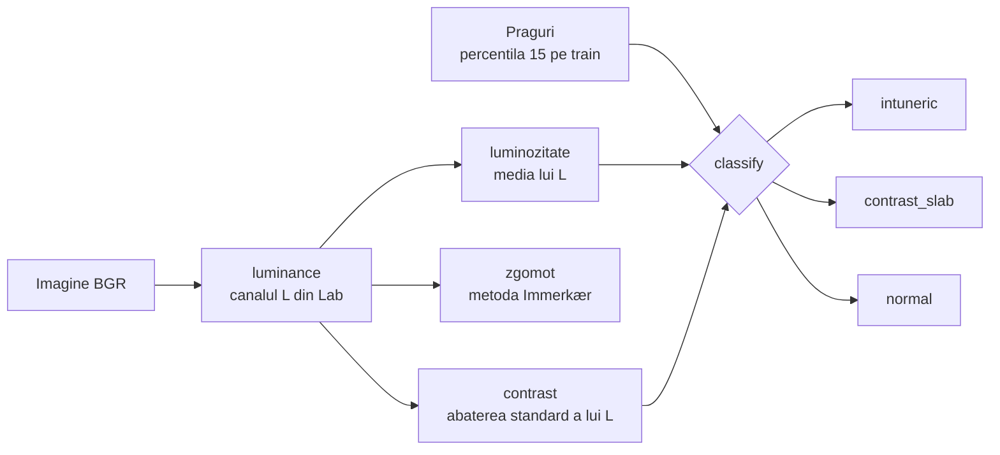

# 2. Analiza statistică a imaginilor

**Cod:** `src/pi_p/stats.py` · **Comandă:** `pi-stats`

## De ce e nevoie de etapa asta

VisDrone conține imagini de zi, de seară și de noapte. Vrem să știm două lucruri:

1. care imagini sunt întunecate sau au contrast slab, ca să le putem îmbunătăți doar pe ele (CLAHE adaptiv, etapa 3);
2. dacă o metodă ajută în special imaginile grele, chiar când media pe tot setul abia se mișcă (evaluarea pe grupe, etapa 8).

Pentru asta, fiecare imagine primește o etichetă: `intuneric`, `contrast_slab` sau `normal`.

## Schema



## Cei trei indicatori

Toți se calculează pe **luminanță**: canalul L din spațiul de culoare Lab, care spune cât de luminos e fiecare pixel, fără culoare. Valorile sunt între 0 (negru) și 255 (alb).

| Indicator | Cum se calculează | Ce înseamnă |
|---|---|---|
| luminozitate | media lui L | mică = imagine întunecată |
| contrast | abaterea standard a lui L | mică = pixelii au valori apropiate, imagine „ștearsă” |
| zgomot | filtru 3 × 3 care anulează muchiile, apoi media răspunsului (Immerkær, 1996) | mare = imagine granulată, tipic noaptea |

Zgomotul este doar raportat în tabel. Nu intră în regula de încadrare, dar ajută la interpretare: CLAHE amplifică zgomotul, deci o imagine întunecată și zgomotoasă poate să nu câștige din el.

## Regula de încadrare

```
dacă luminozitate < prag_luminozitate   → intuneric
altfel dacă contrast < prag_contrast    → contrast_slab
altfel                                  → normal
```

Ordinea contează: o imagine întunecată are de obicei și contrast mic, iar noi vrem să o numim „întuneric”.

## De unde vin pragurile

Pragurile nu sunt alese din ochi. Sunt **percentila 15** a fiecărui indicator pe subsetul train: cele mai întunecate 15% dintre imaginile de antrenare sunt „întuneric”. Pragul de contrast este tot percentila 15, calculată pe toate imaginile de antrenare; dintre imaginile care nu sunt întunecate, cele sub acest prag sunt „contrast slab”.

Două reguli țin evaluarea corectă:

- pragurile se calculează **doar pe train** și se refolosesc pentru val și test, ca la orice parametru învățat din date;
- încadrarea este o etichetă de analiză și nu schimbă împărțirea în train, val și test.

Percentila se poate schimba cu `--percentile`, dar atunci trebuie refăcute și seturile CLAHE adaptive.

## Rezultatul

```
datasets/VisDrone/stats/
    praguri.json    cele două praguri și percentila folosită
    train.csv       o linie pe imagine
    val.csv
    test.csv
```

Un tabel arată așa:

```
imagine,luminozitate,contrast,zgomot,grupa
0000001_02999_d_0000005.jpg,112.431,48.207,1.932,normal
```

## Comandă

```bash
uv run pi-stats            # toate subseturile, ~1 minut
```

Valorile măsurate pe VisDrone sunt în [../rezultate.md](../rezultate.md).
