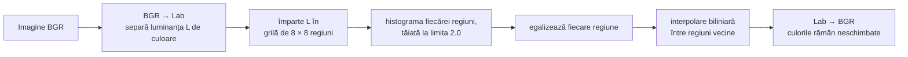
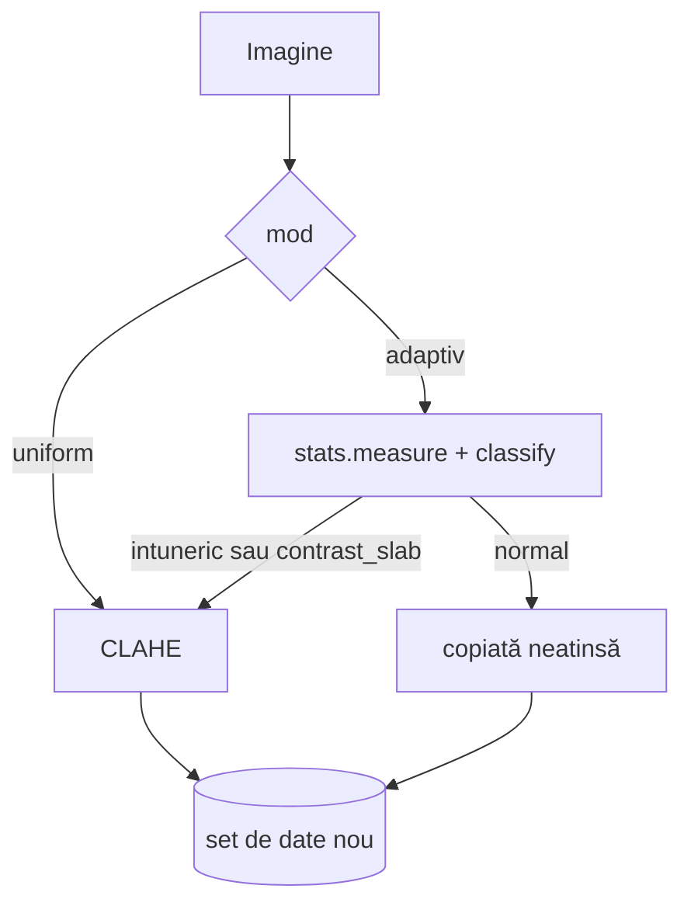

# 3. Îmbunătățirea contrastului (CLAHE)

**Cod:** `src/pi_p/clahe.py` · **Comandă:** `pi-clahe`

## De ce e nevoie de etapa asta

Într-o imagine de noapte, un pieton diferă de asfalt prin câteva niveluri de gri. Ipoteza proiectului este că, dacă mărim contrastul local înainte de detecție, modelul distinge mai ușor astfel de obiecte. Etapa asta produce imaginile îmbunătățite. Dacă ipoteza e adevărată se vede abia la evaluare.

## Cum funcționează CLAHE

Egalizarea obișnuită de histogramă întinde nivelurile de gri pe toată imaginea la fel. Într-o imagine cu o zonă luminată și una în umbră, asta nu ajută zona din umbră. CLAHE (Zuiderveld, 1994) lucrează local:



Cele trei idei din numele metodei:

- **Adaptive:** fiecare regiune din grilă e egalizată după propria histogramă, deci umbra și zona luminată sunt tratate separat.
- **Contrast Limited:** histograma e tăiată la o limită (`clipLimit`), iar surplusul e împărțit uniform. Fără limită, o zonă netedă (cer, asfalt) ar fi întinsă la maximum și zgomotul ei ar deveni vizibil.
- **Interpolarea** dintre regiunile vecine ascunde granițele grilei.

Aplicăm CLAHE doar pe canalul L, pentru că detectorul folosește și culoarea, iar egalizarea separată a canalelor R, G și B ar schimba nuanțele.

Parametrii sunt cei uzuali: limită 2.0 și grilă 8 × 8. Nu îi optimizăm, pentru că fiecare valoare încercată ar cere o reantrenare de câteva ore.

## Cele două variante



| Variantă | Ce imagini primesc CLAHE | Comandă |
|---|---|---|
| uniformă | toate | `pi-clahe uniform` |
| adaptivă | doar grupele `intuneric` și `contrast_slab` | `pi-clahe adaptiv` (cere `pi-stats` înainte) |

Varianta adaptivă există pentru că CLAHE pe o imagine deja bună nu aduce nimic și poate amplifica zgomotul.

## Trei reguli de folosire

1. **Pe imaginea întreagă, înainte de feliere.** CLAHE e deja local, iar indicatorii calculați pe o felie mică sunt instabili.
2. **La fel la antrenare și la testare.** Un model antrenat pe imagini normale și testat pe imagini cu CLAHE primește un tip de imagine pe care nu l-a văzut. De aceea etapa 2 din plan cere reantrenare.
3. **Etichetele nu se schimbă.** CLAHE nu mută niciun pixel, deci chenarele rămân valabile și sunt copiate ca atare.

## Rezultatul

Un set de date nou, cu aceeași structură și aceleași etichete:

```
datasets/VisDrone-clahe-uniform/    sau    datasets/VisDrone-clahe-adaptiv/
    images/train, val, test
    labels/train, val, test
    data.yaml
```

## Comenzi

```bash
uv run pi-clahe uniform
uv run pi-clahe adaptiv

# pentru o singură imagine, fără să scrii un set de date:
uv run pi-predict best.pt imagine.jpg --clahe
```

Lanțul complet pentru etapa 2 din plan (CLAHE → felii → antrenare → evaluare) este în [README.md](README.md#toate-comenzile-în-ordine).
