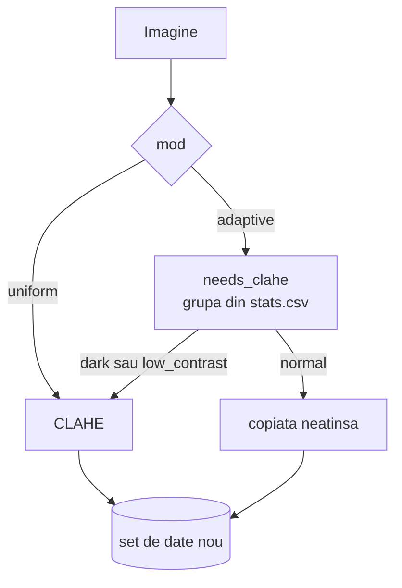

# 3. Imbunatatirea contrastului (CLAHE)

**Cod:** `src/pi_p/enhance.py` · **Comanda:** `pi-clahe`

## De ce e nevoie de etapa asta

Intr-o imagine de noapte, un pieton difera de asfalt prin cateva niveluri de gri. Ipoteza proiectului este ca, daca marim contrastul local inainte de detectie, modelul distinge mai usor astfel de obiecte. Etapa asta produce imaginile imbunatatite. Daca ipoteza e adevarata se vede abia la evaluare.

## Cum functioneaza CLAHE

Egalizarea obisnuita de histograma intinde nivelurile de gri pe toata imaginea la fel. Intr-o imagine cu o zona luminata si una in umbra, asta nu ajuta zona din umbra. CLAHE (Zuiderveld, 1994) lucreaza local:


Cele trei idei din numele metodei:

- **Adaptive:** fiecare regiune din grila e egalizata dupa propria histograma, deci umbra si zona luminata sunt tratate separat.
- **Contrast Limited:** histograma e taiata la o limita (`clipLimit`), iar surplusul e impartit uniform. Fara limita, o zona neteda (cer, asfalt) ar fi intinsa la maximum si zgomotul ei ar deveni vizibil.
- **Interpolarea** dintre regiunile vecine ascunde granitele grilei.

Aplicam CLAHE doar pe canalul L, pentru ca detectorul foloseste si culoarea, iar egalizarea separata a canalelor R, G si B ar schimba nuantele.

Parametrii sunt cei uzuali: limita 2.0 si grila 8 × 8. Nu ii optimizam, pentru ca fiecare valoare incercata ar cere o reantrenare de cateva ore.

## Cele doua variante



| Varianta | Ce imagini primesc CLAHE | Comanda |
|---|---|---|
| uniforma | toate | `pi-clahe --mode uniform` |
| adaptiva | doar grupele `dark` si `low_contrast` | `pi-clahe --mode adaptive` (cere `pi-stats` inainte) |

Varianta adaptiva exista pentru ca CLAHE pe o imagine deja buna nu aduce nimic si poate amplifica zgomotul.

## Trei reguli de folosire

1. **Pe imaginea intreaga, inainte de feliere.** CLAHE e deja local, iar indicatorii calculati pe o felie mica sunt instabili.
2. **La fel la antrenare si la testare.** Un model antrenat pe imagini normale si testat pe imagini cu CLAHE primeste un tip de imagine pe care nu l-a vazut. De aceea etapa 2 din plan cere reantrenare.
3. **Etichetele nu se schimba.** CLAHE nu muta niciun pixel, deci chenarele raman valabile si sunt copiate ca atare.

Imaginile modificate sunt salvate ca JPEG de calitate 95, iar cele care nu primesc CLAHE sunt copiate neatinse.

## Rezultatul

Un set de date nou, cu aceeasi structura si aceleasi etichete:

```
datasets/VisDrone-clahe/    sau    datasets/VisDrone-clahe-adaptive/
    images/train, val, test
    labels/train, val, test
    data.yaml
```

## Comenzi

```bash
uv run pi-clahe --mode uniform
uv run pi-clahe --mode adaptive
uv run pi-clahe --mode uniform --clip 3.0 --dst datasets/VisDrone-clahe3   # alti parametri
```

Lantul complet pentru etapa 2 din plan (CLAHE → felii → antrenare → evaluare) este in [README.md](README.md#toate-comenzile-in-ordine).
