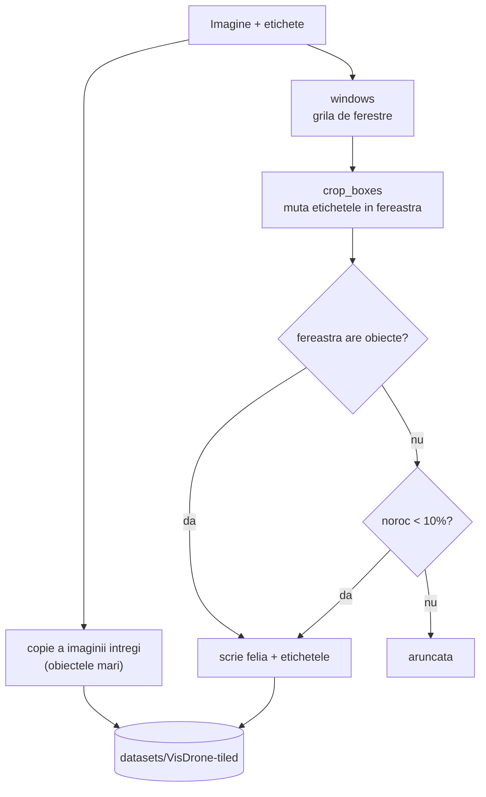

# 4. Felierea pe grila fixa

**Cod:** `src/pi_p/slicing.py` (grila), `src/pi_p/tile.py` (felii pentru antrenare) · **Comanda:** `pi-tile`

## De ce e nevoie de etapa asta

YOLO primeste imagini de 640 px pe latura mare. O imagine VisDrone de 1920 × 1080 e micsorata de 3 ori, deci un pieton de 12 × 30 px ajunge la 4 × 10 px, prea mic ca reteaua sa il mai distinga.

Solutia: in loc sa micsoram imaginea, o taiem in ferestre de 640 × 640 si dam modelului fiecare fereastra la rezolutia ei reala. Pietonul ramane de 12 × 30 px.

## Cum se asaza ferestrele

Ferestrele se suprapun cu 20%, adica pasul dintre ele este 640 × (1 − 0.2) = 512 px. Ultima fereastra de pe fiecare rand si coloana e lipita de marginea imaginii, ca sa nu ramana nimic neacoperit.

Exemplu pe o imagine de 1360 × 765:

```
latime 1360:  ferestre care incep la x = 0, 512, 720      (720 = 1360 − 640)
inaltime 765: ferestre care incep la y = 0, 125           (125 = 765 − 640)

pe orizontala, fiecare fereastra acopera 640 px:

    x:  0        512  640 720        1152      1360
    A   ├──────────────┤
    B            ├──────────────────────┤
    C                      ├──────────────────────┤

3 coloane × 2 randuri = 6 ferestre
```

Ferestrele A si B au in comun banda 512–640. Ultima fereastra, C, nu porneste la 1024 (ar iesi din imagine), ci e trasa inapoi la 720, deci se suprapune mai mult cu B.

Functia `starts` calculeaza pozitiile pe o latura, iar `windows` le combina pe cele doua laturi.

## De ce se suprapun ferestrele

Un obiect aflat exact pe granita dintre doua ferestre ar fi taiat in doua si nu ar aparea intreg nicaieri. Cu o suprapunere de 128 px, orice obiect mai mic de 128 px apare intreg in cel putin o fereastra. Pretul sunt detectiile duble din zona comuna, rezolvate la [fuziune](07-fuziunea-detectiilor.md).

## Felierea pentru antrenare (`pi-tile`)

Ca modelul sa fie antrenat pe acelasi tip de imagine pe care il primeste la test, taiem si imaginile de antrenare in felii.



Trei decizii, fiecare cu motivul ei:

| Decizie | Parametru | De ce |
|---|---|---|
| Un obiect taiat de fereastra e pastrat doar daca ramane vizibil cel putin 50% din el | `--min-visibility 0.5` | altfel modelul invata sa detecteze „un colt de masina” |
| Feliile fara obiecte sunt pastrate doar in proportie de 10% | `--empty 0.1` | modelul trebuie sa vada si fundal, dar nu sa fie dominat de el |
| Se pastreaza si imaginea intreaga | implicit; `--no-full` o scoate | obiectele mari (autobuze aproape de camera) nu incap intr-o felie |

Etichetele se muta in coordonatele feliei scazand coltul ei stanga-sus (`crop_boxes`). Numele feliei spune de unde vine: `0000001_512_125.jpg` este felia care incepe la x = 512, y = 125.

## Rezultatul pe VisDrone

| Subset | Imagini | Fisiere dupa feliere |
|---|---|---|
| train | 6471 | 46 483 |
| val | 548 | 3 320 |

Setul de antrenare creste de aproximativ 7 ori, deci si timpul unei epoci: de la ~45 de secunde la ~5 minute pe RTX 4070 SUPER.

## Comenzi

```bash
uv run pi-tile                       # datasets/VisDrone → datasets/VisDrone-tiled
uv run pi-check --root datasets/VisDrone-tiled
```

Feliile din `val` sunt folosite doar de Ultralytics, ca sa urmareasca antrenarea. Rezultatele raportate se calculeaza altfel, pe imaginile intregi ([evaluarea](08-evaluarea.md)).
