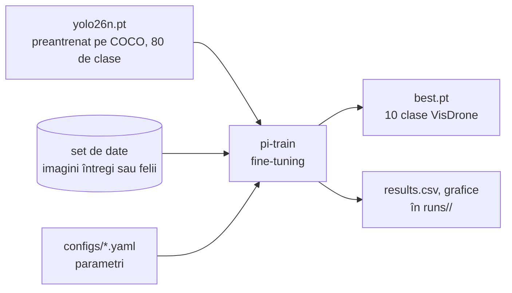

# 5. Antrenarea modelului

**Cod:** `src/pi_p/train.py`, `src/pi_p/config.py`, `configs/*.yaml` · **Comandă:** `pi-train`

## Ce se antrenează

Modelul este **YOLO26n**, cea mai mică variantă din familia YOLO26 (aproximativ 2,4 milioane de parametri). Nu pornim de la zero: plecăm de la greutățile preantrenate pe COCO (`yolo26n.pt`), care știu deja să recunoască muchii, forme și obiecte obișnuite, și le adaptăm la imaginile de dronă. Procedeul se numește **fine-tuning**.

Antrenarea nu face parte din drumul unei imagini prin sistem. Se face o dată, iar rezultatul ei, fișierul `best.pt`, este folosit apoi de detecție.



## Configurațiile

Parametrii stau în fișiere YAML, nu în cod, ca fiecare experiment să fie descris într-un singur loc.

| Fișier | Date | Scop |
|---|---|---|
| `configs/smoke.yaml` | 5% din VisDrone, 1 epocă | verifică în ~1 minut că totul rulează |
| `configs/train.yaml` | imagini întregi | baseline-ul: referința tuturor comparațiilor |
| `configs/train_tiled.yaml` | felii (`VisDrone-tiled`) | modelul antrenat pe felii |

Parametrii din `train.yaml`:

| Parametru | Valoare | Ce înseamnă |
|---|---|---|
| `model` | `yolo26n.pt` | greutățile de la care pornim |
| `data` | `datasets/VisDrone/data.yaml` | setul de date |
| `epochs` | 100 | de câte ori trece prin tot setul de antrenare |
| `imgsz` | 640 | latura la care sunt aduse imaginile |
| `batch` | 16 | câte imagini vede într-un pas |
| `patience` | 20 | se oprește dacă 20 de epoci la rând nu aduc îmbunătățire |
| `name` | `yolo26n_640` | numele folderului de rezultate |

Orice parametru se poate schimba din linia de comandă, fără a edita fișierul:

```bash
uv run pi-train configs/train.yaml epochs=50 batch=8
```

Așa se antrenează și variantele CLAHE: aceeași configurare, cu alt `data` și alt `name`.

## Ce se întâmplă într-o epocă

1. Modelul primește imaginile de antrenare în grupuri de 16, cu augmentări aleatoare (oglindire, schimbări de culoare, mozaic din 4 imagini).
2. Pentru fiecare grup, compară ce a prezis cu etichetele și își corectează greutățile.
3. La sfârșitul epocii rulează pe subsetul val și calculează mAP.
4. Dacă mAP-ul e cel mai bun de până acum, salvează greutățile ca `best.pt`.

`patience` oprește antrenarea când modelul nu mai învață nimic nou (early stopping). Baseline-ul nostru s-a oprit astfel la epoca 97, cu cel mai bun rezultat la epoca 77.

## O capcană: mAP-ul din timpul antrenării pe felii

În timpul antrenării, Ultralytics calculează mAP pe `val` din setul pe care îl primește. Pentru modelul pe felii, acel `val` conține felii, în care obiectele apar mari. Valoarea afișată (0.487) **nu se poate compara** cu cea a baseline-ului (0.343), măsurată pe imagini întregi.

Comparația corectă se face cu `pi-eval`, care rulează toate modelele pe aceleași imagini întregi. Vezi [evaluarea](08-evaluarea.md).

## Rezultatul

```
runs/yolo26n_640/
    weights/best.pt      cel mai bun model
    weights/last.pt      modelul de la ultima epocă
    results.csv          loss și mAP la fiecare epocă
    results.png          aceleași valori, ca grafice
```

## Comenzi

```bash
uv run pi-train configs/smoke.yaml         # test rapid
uv run pi-train configs/train.yaml         # ~1,2 ore pe RTX 4070 SUPER
uv run pi-train configs/train_tiled.yaml   # ~7,7 ore; cere pi-tile înainte
```
