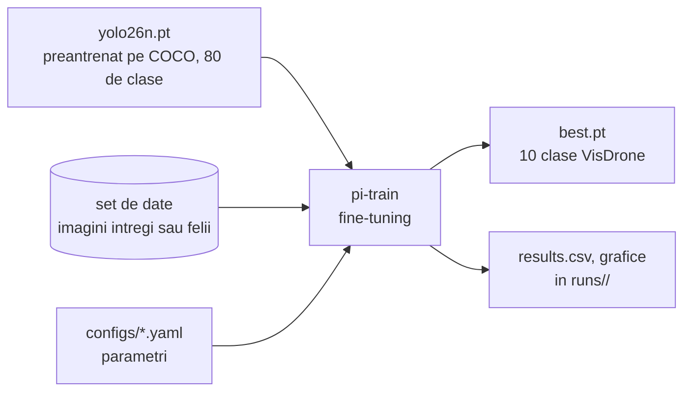

# 5. Antrenarea modelului

**Cod:** `src/pi_p/train.py`, `src/pi_p/config.py`, `configs/*.yaml` · **Comanda:** `pi-train`

## Ce se antreneaza

Modelul este **YOLO26n**, cea mai mica varianta din familia YOLO26 (aproximativ 2,4 milioane de parametri). Nu pornim de la zero: plecam de la greutatile preantrenate pe COCO (`yolo26n.pt`), care stiu deja sa recunoasca muchii, forme si obiecte obisnuite, si le adaptam la imaginile de drona. Procedeul se numeste **fine-tuning**.

Antrenarea nu face parte din drumul unei imagini prin sistem. Se face o data, iar rezultatul ei, fisierul `best.pt`, este folosit apoi de detectie.



## Configuratiile

Parametrii stau in fisiere YAML, nu in cod, ca fiecare experiment sa fie descris intr-un singur loc.

| Fisier | Date | Scop |
|---|---|---|
| `configs/smoke.yaml` | 5% din VisDrone, 1 epoca | verifica in ~1 minut ca totul ruleaza |
| `configs/train.yaml` | imagini intregi | baseline-ul: referinta tuturor comparatiilor |
| `configs/train_tiled.yaml` | felii (`VisDrone-tiled`) | modelul antrenat pe felii |

Parametrii din `train.yaml`:

| Parametru | Valoare | Ce inseamna |
|---|---|---|
| `model` | `yolo26n.pt` | greutatile de la care pornim |
| `data` | `datasets/VisDrone/data.yaml` | setul de date |
| `epochs` | 100 | de cate ori trece prin tot setul de antrenare |
| `imgsz` | 640 | latura la care sunt aduse imaginile |
| `batch` | 16 | cate imagini vede intr-un pas |
| `patience` | 20 | se opreste daca 20 de epoci la rand nu aduc imbunatatire |
| `name` | `yolo26n_640` | numele folderului de rezultate |

Orice parametru se poate schimba din linia de comanda, fara a edita fisierul:

```bash
uv run pi-train configs/train.yaml epochs=50 batch=8
```

Asa se antreneaza si variantele CLAHE: aceeasi configurare, cu alt `data` si alt `name`.

## Ce se intampla intr-o epoca

1. Modelul primeste imaginile de antrenare in grupuri de 16, cu augmentari aleatoare (oglindire, schimbari de culoare, mozaic din 4 imagini).
2. Pentru fiecare grup, compara ce a prezis cu etichetele si isi corecteaza greutatile.
3. La sfarsitul epocii ruleaza pe subsetul val si calculeaza mAP.
4. Daca mAP-ul e cel mai bun de pana acum, salveaza greutatile ca `best.pt`.

`patience` opreste antrenarea cand modelul nu mai invata nimic nou (early stopping). Baseline-ul nostru s-a oprit astfel la epoca 97, cu cel mai bun rezultat la epoca 77.

## O capcana: mAP-ul din timpul antrenarii pe felii

In timpul antrenarii, Ultralytics calculeaza mAP pe `val` din setul pe care il primeste. Pentru modelul pe felii, acel `val` contine felii, in care obiectele apar mari. Valoarea afisata (0.487) **nu se poate compara** cu cea a baseline-ului (0.343), masurata pe imagini intregi.

Comparatia corecta se face cu `pi-eval`, care ruleaza toate modelele pe aceleasi imagini intregi. Vezi [evaluarea](08-evaluarea.md).

## Rezultatul

```
runs/yolo26n_640/
    weights/best.pt      cel mai bun model
    weights/last.pt      modelul de la ultima epoca
    results.csv          loss si mAP la fiecare epoca
    results.png          aceleasi valori, ca grafice
```

## Comenzi

```bash
uv run pi-train configs/smoke.yaml         # test rapid
uv run pi-train configs/train.yaml         # ~1,2 ore pe RTX 4070 SUPER
uv run pi-train configs/train_tiled.yaml   # ~7,7 ore; cere pi-tile inainte
```
