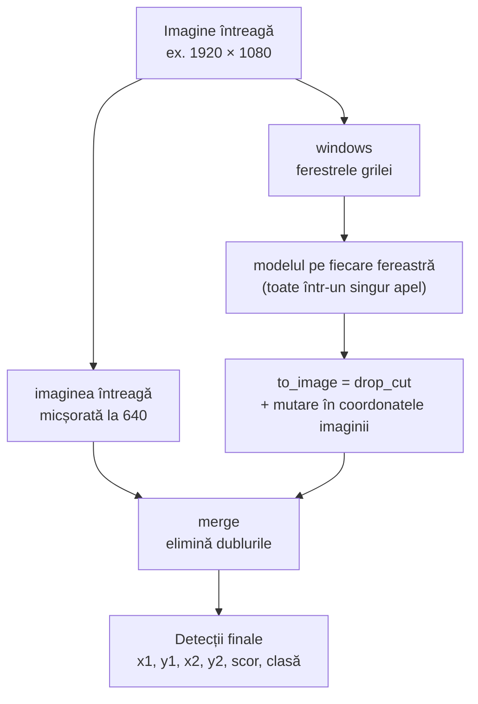

# 6. Detecția pe ferestre

**Cod:** `sliced_predict` din `src/pi_p/predict.py` · **Comandă:** `pi-predict`

## Ideea

La inferență facem același lucru ca la antrenarea pe felii: tăiem imaginea în ferestre și rulăm modelul pe fiecare, la rezoluția ei reală. Apoi adunăm toate detecțiile într-o singură listă, în coordonatele imaginii întregi.

Pe lângă ferestre, modelul vede și **imaginea întreagă, micșorată**. Ea prinde obiectele mari, care nu încap într-o fereastră de 640 px.

## Schema



## Unde e folosită

Aceeași funcție, `sliced_predict`, e folosită de `pi-predict --slice`, de `pi-eval --mode slice` și de serverul web, deci ce evaluăm este exact ce rulează.

| `pi-eval --mode` | Ce vede modelul | Cod |
|---|---|---|
| `full` | doar imaginea micșorată | `model.predict` |
| `slice` | imaginea micșorată + toate ferestrele grilei | `sliced_predict` |
| `sahi` | aceleași ferestre, cu biblioteca SAHI | `sahi_detect` din `evaluate.py` |
| `adaptive` | imaginea micșorată + ferestre doar unde sunt obiecte | `adaptive_predict` din `adaptive.py` |

Ferestrele adaptive sunt explicate în [etapa 9](09-ferestre-adaptive.md).

## Mutarea chenarelor în imaginea întreagă

Modelul întoarce chenarele în coordonatele ferestrei, cu originea în colțul ei stânga-sus. Ca să le aducem în imaginea întreagă, adunăm poziția ferestrei:

```
fereastra începe la (512, 0)
chenar în fereastră:        (100, 50) – (140, 90)
chenar în imaginea întreagă: (612, 50) – (652, 90)
```

În cod este o singură adunare, în `to_image`: `det + [x1, y1, x1, y1, 0, 0]`. Ultimele două zerouri lasă scorul și clasa neschimbate. Aceeași funcție e folosită și pentru ferestrele adaptive.

## Câte detecții păstrăm

Ultralytics întoarce implicit cel mult 300 de detecții pentru fiecare imagine sau fereastră. La evaluare, `pi-eval` păstrează pe imagine cel mult 300 de detecții, dar niciodată mai puține decât numărul de obiecte adnotate din cea mai aglomerată imagine (până la ~900 în VisDrone). Altfel, limita ar tăia detecții corecte.

## Cât costă

O imagine de 1920 × 1080 are 8 ferestre de grilă (4 pe orizontală, 2 pe verticală), plus imaginea întreagă: 9 rulări ale modelului în loc de una. Imaginile din val sunt în medie mai mici și au 5,2 ferestre. Măsurat pe val, timpul pe imagine crește de la ~8–10 ms la ~35–45 ms, adică de aproximativ 4 ori. Valorile sunt în [../rezultate.md](../rezultate.md).

## Comenzi

```bash
# imagine întreagă; merge și pe video sau URL
uv run pi-predict best.pt imagine.jpg

# pe grila de ferestre de 640 px
uv run pi-predict best.pt folder_cu_imagini/ --slice 640
```

Imaginile cu detecțiile desenate ajung în `runs/predict/`.
