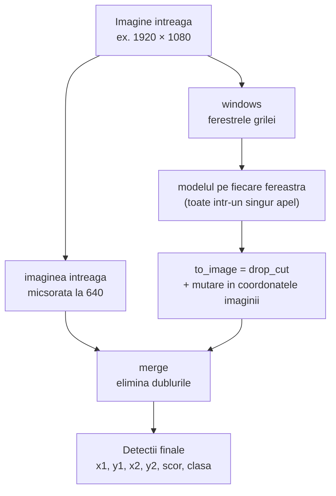

# 6. Detectia pe ferestre

**Cod:** `sliced_predict` din `src/pi_p/predict.py` · **Comanda:** `pi-predict`

## Ideea

La inferenta facem acelasi lucru ca la antrenarea pe felii: taiem imaginea in ferestre si rulam modelul pe fiecare, la rezolutia ei reala. Apoi adunam toate detectiile intr-o singura lista, in coordonatele imaginii intregi.

Pe langa ferestre, modelul vede si **imaginea intreaga, micsorata**. Ea prinde obiectele mari, care nu incap intr-o fereastra de 640 px.

## Schema



## Unde e folosita

Aceeasi functie, `sliced_predict`, e folosita de `pi-predict --slice`, de `pi-eval --mode slice` si de serverul web, deci ce evaluam este exact ce ruleaza.

| `pi-eval --mode` | Ce vede modelul | Cod |
|---|---|---|
| `full` | doar imaginea micsorata | `model.predict` |
| `slice` | imaginea micsorata + toate ferestrele grilei | `sliced_predict` |
| `sahi` | aceleasi ferestre, cu biblioteca SAHI | `sahi_detect` din `evaluate.py` |
| `adaptive` | imaginea micsorata + ferestre doar unde sunt obiecte | `adaptive_predict` din `adaptive.py` |

Ferestrele adaptive sunt explicate in [etapa 9](09-ferestre-adaptive.md).

## Mutarea chenarelor in imaginea intreaga

Modelul intoarce chenarele in coordonatele ferestrei, cu originea in coltul ei stanga-sus. Ca sa le aducem in imaginea intreaga, adunam pozitia ferestrei:

```
fereastra incepe la (512, 0)
chenar in fereastra:        (100, 50) – (140, 90)
chenar in imaginea intreaga: (612, 50) – (652, 90)
```

In cod este o singura adunare, in `to_image`: `det + [x1, y1, x1, y1, 0, 0]`. Ultimele doua zerouri lasa scorul si clasa neschimbate. Aceeasi functie e folosita si pentru ferestrele adaptive.

## Cate detectii pastram

Ultralytics intoarce implicit cel mult 300 de detectii pentru fiecare imagine sau fereastra. La evaluare, `pi-eval` pastreaza pe imagine cel mult 300 de detectii, dar niciodata mai putine decat numarul de obiecte adnotate din cea mai aglomerata imagine (pana la ~900 in VisDrone). Altfel, limita ar taia detectii corecte.

## Cat costa

O imagine de 1920 × 1080 are 8 ferestre de grila (4 pe orizontala, 2 pe verticala), plus imaginea intreaga: 9 rulari ale modelului in loc de una. Imaginile din val sunt in medie mai mici si au 5,2 ferestre. Masurat pe val, timpul pe imagine creste de la ~8–10 ms la ~35–45 ms, adica de aproximativ 4 ori. Valorile sunt in [../rezultate.md](../rezultate.md).

## Comenzi

```bash
# imagine intreaga; merge si pe video sau URL
uv run pi-predict best.pt imagine.jpg

# pe grila de ferestre de 640 px
uv run pi-predict best.pt folder_cu_imagini/ --slice 640
```

Imaginile cu detectiile desenate ajung in `runs/predict/`.
