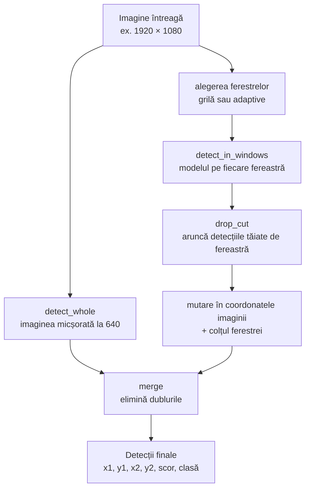

# 6. Detecția pe ferestre

**Cod:** `src/pi_p/predict.py` · **Comandă:** `pi-predict`

## Ideea

La inferență facem același lucru ca la antrenarea pe felii: tăiem imaginea în ferestre și rulăm modelul pe fiecare, la rezoluția ei reală. Apoi adunăm toate detecțiile într-o singură listă, în coordonatele imaginii întregi.

Pe lângă ferestre, modelul vede și **imaginea întreagă, micșorată**. Ea prinde obiectele mari, care nu încap într-o fereastră de 640 px.

## Schema



## Cele patru moduri

Funcția `detect` este punctul comun de intrare. Aceeași funcție e folosită de `pi-predict`, de `pi-eval` și de serverul web, deci ce evaluăm este exact ce rulează.

| Mod | Ce vede modelul | Funcția |
|---|---|---|
| `intreg` | doar imaginea micșorată | `detect_whole` |
| `grila` | imaginea micșorată + toate ferestrele grilei | `sliced_predict` |
| `adaptiv` | imaginea micșorată + ferestre doar unde sunt obiecte | `adaptive_predict` |
| `adaptiv+grila` | imaginea micșorată + ferestrele adaptive + grila | `adaptive_predict(with_grid=True)` |

Modurile adaptive sunt explicate în [etapa 9](09-ferestre-adaptive.md).

## Mutarea chenarelor în imaginea întreagă

Modelul întoarce chenarele în coordonatele ferestrei, cu originea în colțul ei stânga-sus. Ca să le aducem în imaginea întreagă, adunăm poziția ferestrei:

```
fereastra începe la (512, 0)
chenar în fereastră:        (100, 50) – (140, 90)
chenar în imaginea întreagă: (612, 50) – (652, 90)
```

În cod este o singură adunare: `det + [x1, y1, x1, y1, 0, 0]`. Ultimele două zerouri lasă scorul și clasa neschimbate.

## De ce `MAX_DET = 1000`

Ultralytics întoarce implicit cel mult 300 de detecții pe imagine. Imaginile VisDrone au până la aproximativ 900 de obiecte, deci limita ar tăia detecții corecte. O ridicăm la 1000.

## Cât costă

O imagine de 1920 × 1080 are 8 ferestre de grilă (4 pe orizontală, 2 pe verticală), plus imaginea întreagă: 9 rulări ale modelului în loc de una. Imaginile din val sunt în medie mai mici și au 5,2 ferestre. Măsurat pe val, timpul pe imagine crește de la ~8–10 ms la ~35–45 ms, adică de aproximativ 4 ori. Valorile sunt în [../rezultate.md](../rezultate.md).

## Comenzi

```bash
# imagine întreagă; merge și pe video sau URL
uv run pi-predict best.pt imagine.jpg

# pe grila de ferestre de 640 px
uv run pi-predict best.pt folder_cu_imagini/ --slice 640

# ferestre adaptive
uv run pi-predict best.pt imagine.jpg --slice 640 --windows adaptiv
```

Imaginile cu detecțiile desenate ajung în `runs/predict/`.
