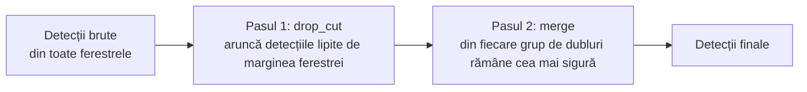

# 7. Fuziunea detecțiilor

**Cod:** `drop_cut`, `to_image` și `merge` din `src/pi_p/predict.py` · folosite de grilă și de ferestrele adaptive

## Problema

Ferestrele se suprapun, iar modelul vede și imaginea întreagă. De aceea, lista brută de detecții are două feluri de greșeli:

1. **Bucăți de obiecte.** O mașină tăiată de marginea unei ferestre e detectată ca „jumătate de mașină”, cu un chenar prea mic.
2. **Dubluri.** O mașină din zona comună a două ferestre e detectată în amândouă, plus o dată în imaginea întreagă.

Fuziunea le rezolvă în doi pași, în ordinea asta.



## Pasul 1: eliminarea detecțiilor tăiate (`drop_cut`)

O detecție este aruncată dacă atinge, la cel mult 2 px, o margine a ferestrei aflată **în interiorul imaginii**.

```
        imaginea întreagă
   ┌──────────────────────────────┐
   │  fereastra A     ┆           │
   │            ┌─────┆──┐        │   mașina e tăiată de marginea dreaptă a lui A:
   │            │ mașină │        │   în A apare doar partea stângă → aruncată din A
   │            └─────┆──┘        │   în fereastra B, vecină, apare întreagă → păstrată
   │                  ┆           │
   └──────────────────────────────┘
```

De ce e sigur să o aruncăm: datorită suprapunerii, obiectul apare întreg în fereastra vecină.

Excepția: marginile ferestrei care coincid cu marginea imaginii. Acolo obiectul e tăiat de fotografie, nu de fereastră, și nicio altă fereastră nu îl vede mai bine. În cod, fiecare dintre cele patru margini e verificată doar dacă fereastra nu e lipită de marginea respectivă a imaginii (`if x1 > 0`, `if x2 < w` etc.).

## Pasul 2: eliminarea dublurilor (`merge`)

Este o suprimare a non-maximelor (NMS):

1. ordonăm detecțiile descrescător după scor;
2. luăm prima detecție și o păstrăm;
3. aruncăm toate detecțiile de aceeași clasă care se suprapun puternic cu ea;
4. repetăm cu următoarea detecție rămasă.

### De ce IOS și nu IoU

Suprapunerea a două chenare se măsoară de obicei cu IoU:

```
IoU(A, B) = aria(A ∩ B) / aria(A ∪ B)
IOS(A, B) = aria(A ∩ B) / min(aria(A), aria(B))
```

IoU are o problemă cu bucățile care au scăpat de pasul 1. Exemplu: mașina întreagă are chenarul de 100 × 50 px, iar o bucată detectată din ea are 40 × 50 px și e complet în interior.

| Măsură | Calcul | Valoare | La pragul 0,5 |
|---|---|---|---|
| IoU | 2000 / 5000 | 0,40 | bucata e **păstrată** (greșit) |
| IOS | 2000 / 2000 | 1,00 | bucata e **eliminată** (corect) |

IOS (Intersection over Smaller) împarte la aria chenarului mai mic, deci spune „cât din chenarul mic e acoperit de cel mare”. Un chenar aflat aproape complet în interiorul altuia de aceeași clasă este aproape sigur o bucată din același obiect.

Pragul implicit este 0,5 și se poate schimba cu `--iou`.

### De ce doar între detecții de aceeași clasă

Un pieton urcat pe o motocicletă are chenarul aproape complet în interiorul chenarului motocicletei. Sunt două obiecte reale, de clase diferite, și trebuie păstrate amândouă.

## Un exemplu complet

Testul `test_merge_drops_fragments_inside_larger_box` din `tests/test_slicing.py`:

| Detecție | Chenar | Scor | Clasă | Rezultat |
|---|---|---|---|---|
| 1 | (0, 0) – (100, 50) | 0,9 | truck | păstrată: cel mai mare scor |
| 2 | (0, 0) – (40, 50) | 0,6 | truck | eliminată: e în interiorul lui 1, aceeași clasă |
| 3 | (10, 10) – (30, 30) | 0,8 | pedestrian | păstrată: e în interiorul lui 1, dar altă clasă |
| 4 | (200, 200) – (220, 220) | 0,7 | truck | păstrată: nu se suprapune cu nimic |
