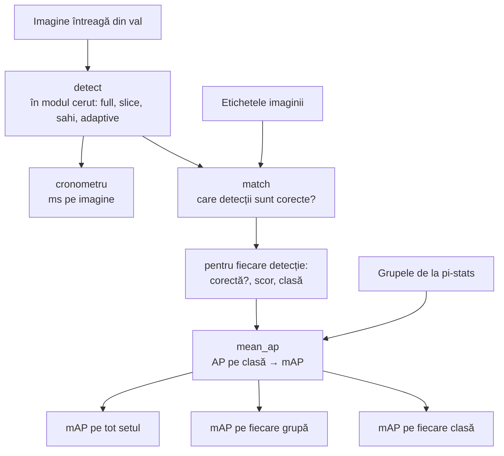

# 8. Evaluarea

**Cod:** `src/pi_p/evaluate.py`, `src/pi_p/metrics.py` · **Comandă:** `pi-eval`

## Ce măsurăm

Vrem un singur număr care spune cât de bine detectează o variantă, ca să putem compara variantele între ele. Numărul este **mAP** (mean Average Precision). Pe lângă el măsurăm **timpul pe imagine**, pentru că felierea face detecția mai bună, dar și mai lentă.

## Regula de bază: toate variantele sunt evaluate la fel

- pe **imaginile întregi** din val, după fuziunea detecțiilor;
- cu **etichetele imaginii întregi** ca referință;
- cu **același prag de încredere**, mic (0,001).

Dacă am evalua modelul pe felii pe feliile lui, obiectele ar apărea mari și scorul ar ieși mai mare fără ca modelul să fie mai bun. Pragul trebuie să fie mic și același pentru că mAP se calculează coborând treptat pragul; o variantă evaluată cu prag mai mare ar pierde partea de jos a curbei.

## Schema



## De la detecții la mAP, în patru pași

### 1. Când e corectă o detecție (`metrics.match`)

O detecție este corectă dacă are **aceeași clasă** cu un obiect adnotat și chenarele lor se suprapun suficient:

```
IoU = aria intersecției / aria reuniunii   ≥ prag
```

Fiecare obiect adnotat poate fi „folosit” o singură dată. Dacă două detecții nimeresc aceeași mașină, doar cea cu IoU mai mare e corectă; cealaltă e o alarmă falsă.

### 2. Precizie și recall

```
precizie = detecții corecte / toate detecțiile        cât din ce am zis e adevărat
recall   = detecții corecte / toate obiectele reale   cât din ce există am găsit
```

Cele două trag în direcții opuse. Cu un prag de încredere mare, modelul spune puține lucruri, dar sigure (precizie mare, recall mic). Cu un prag mic, găsește mai mult, dar și greșește mai mult.

### 3. AP: aria de sub curba precizie–recall

Ordonăm toate detecțiile unei clase după scor și coborâm pragul treptat. La fiecare pas notăm precizia și recall-ul, ceea ce dă o curbă. **AP** (Average Precision) este aria de sub ea: 1 pentru un detector perfect, 0 pentru unul care nu nimerește nimic. AP nu depinde de un prag ales de noi, pentru că le acoperă pe toate.

### 4. mAP: media pe clase

**mAP** este media AP-urilor celor 10 clase. Fiecare clasă cântărește la fel, deci o clasă rară și grea (awning-tricycle) trage media în jos la fel de mult cât o ridică una frecventă și ușoară (car).

Raportăm două variante:

| Metrică | Prag IoU | Ce recompensează |
|---|---|---|
| mAP50 | 0,5 | găsirea obiectului, chiar cu un chenar aproximativ |
| mAP50-95 | media pe 0,50, 0,55, …, 0,95 | și potrivirea exactă a chenarului |

## Evaluarea pe grupe

Cu `--groups datasets/VisDrone/stats.csv` (tabelul scris de `pi-stats`), aceleași calcule se repetă separat pentru imaginile `dark`, `low_contrast` și `normal`. Așa vedem dacă o metodă, de exemplu CLAHE, ajută imaginile grele chiar când media pe tot setul abia se schimbă.

Grupele trebuie să vină mereu din imaginile **originale** (`datasets/VisDrone/stats.csv`), și atunci când evaluăm un set cu CLAHE. Altfel, după CLAHE, imaginile întunecate n-ar mai părea întunecate și grupele n-ar mai fi aceleași de la o variantă la alta.

## Timpul pe imagine

Timpul se măsoară în jurul apelului `detect`, deci include toate rulările modelului și fuziunea, dar nu citirea imaginii de pe disc. Înainte de măsurare, primele 3 imagini sunt rulate o dată în plus, necronometrat, pentru că acolo se încarcă modelul pe placa video.

## De ce valorile diferă de cele din antrenare

`pi-eval --mode full` nu dă exact același mAP ca `pi-eval --mode val`, care rulează validarea Ultralytics (`model.val`). Diferența vine din felul în care imaginea e redimensionată și completată cu margini înainte de a intra în model, care nu e identic în cele două căi. Potrivirea detecțiilor cu etichetele este testată în `tests/test_metrics.py`.

Pentru comparații contează că **toate variantele trec prin aceeași cale**, cea din `pi-eval --mode full/slice/sahi/adaptive`. Nu se compară un număr din această cale cu unul din jurnalul de antrenare sau din `--mode val`.

## Rolul subseturilor

| Subset | La ce e folosit |
|---|---|
| train | doar antrenare |
| val | toate comparațiile și toate deciziile |
| test | o singură rulare, la final, după ce deciziile sunt înghețate |

Dacă am alege varianta cea mai bună uitându-ne la test, rezultatul raportat pe test ar fi prea optimist.

## Comenzi

```bash
uv run pi-eval weights/yolo26n_baseline_640.pt --mode full                        # baseline
uv run pi-eval weights/yolo26n_tiled.pt --mode slice                               # model pe felii, pe grilă
uv run pi-eval weights/yolo26n_tiled.pt --mode slice --groups datasets/VisDrone/stats.csv --out logs/eval/nume.json
uv run pi-eval weights/yolo26n_tiled.pt --mode slice --split test                  # doar la final
uv run pi-eval yolo26n.pt --mode val --coco                                        # model COCO, fără fine-tuning
```
