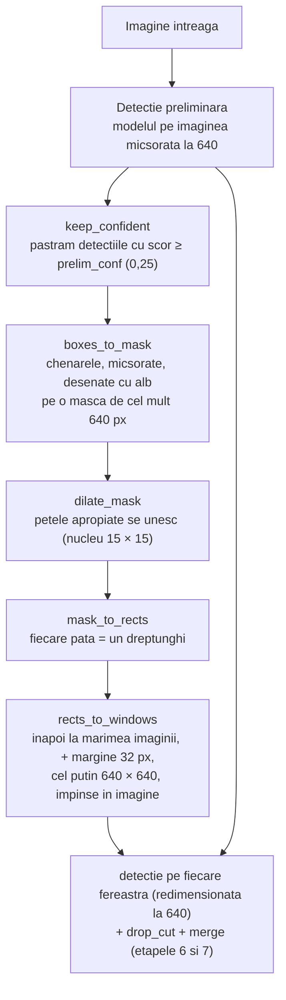

# 9. Ferestrele adaptive

**Cod:** `src/pi_p/adaptive.py` · **Parametri:** `configs/adaptive.yaml` · **Folosire:** `pi-eval --mode adaptive`

## De ce e nevoie de etapa asta

Grila fixa ruleaza modelul pe toata imaginea, inclusiv pe campuri, acoperisuri si apa, unde nu e nimic de gasit. Ferestrele adaptive pun ferestre **doar acolo unde par sa fie obiecte**.

Intrebarea „unde par sa fie obiecte?” primeste un raspuns ieftin: ne uitam la detectiile de pe imaginea micsorata, pe care modelul o proceseaza oricum.

## Schema



Functia `adaptive_trace` intoarce si toate etapele intermediare (masca, masca dilatata, dreptunghiurile, ferestrele). Din ele, `adaptive_figure.py` deseneaza figura pas cu pas a metodei.

## Pasii, pe un exemplu

Imagine de 1920 × 1080 cu o intersectie in stanga-sus si o parcare in dreapta-jos. Restul e camp.

**1. Detectia preliminara.** Pe imaginea micsorata la 640 px, modelul gaseste o parte dintre masini. Pastram doar detectiile cu scor de cel putin 0,25. Nu ne trebuie chenare exacte, doar zona.

**2. Masca.** Masca se face la o rezolutie mica, de cel mult `mask_size = 640` px pe latura mare (aici 640 × 360, adica de 3 ori mai mica). Chenarele sunt micsorate la fel si desenate cu alb pe fundal negru. Pe o masca mica, dilatarea si cautarea petelor sunt rapide.

```
┌────────────────────────────────┐
│ ▪▪ ▪                           │
│ ▪ ▪▪                           │
│                                │
│                         ▪ ▪▪   │
│                         ▪▪ ▪   │
└────────────────────────────────┘
```

**3. Dilatarea.** Fiecare pata alba e ingrosata cu un nucleu de 15 × 15 pixeli de masca, adica 7 pixeli in fiecare directie, cam 21 de pixeli ai imaginii intregi la exemplul nostru. Petele apropiate se ating si devin una singura. Nucleul trebuie sa aiba latura impara, ca sa aiba un pixel central si masca sa creasca la fel in toate directiile.

```
┌────────────────────────────────┐
│ ██████                         │
│ ██████                         │
│                                │
│                        ██████  │
│                        ██████  │
└────────────────────────────────┘
```

**4. Dreptunghiurile.** `cv2.connectedComponentsWithStats` numara petele si intoarce dreptunghiul care incadreaza fiecare: aici, doua.

**5. Ferestrele.** Fiecare dreptunghi devine o fereastra:

| Pas | Ce face |
|---|---|
| `scale_rects` | readuce dreptunghiul la marimea imaginii intregi (× 3) |
| `grow_rects` | adauga o margine de 32 px pe fiecare latura, ca obiectele de pe margine sa nu fie taiate |
| `enforce_min_size` | daca e mai mic de 640 × 640, il largeste in jurul centrului |
| `fit_in_image` | daca iese din imagine, il impinge inapoi in ea |

Fereastra poate fi deci **mai mare** de 640 px, daca grupul e mare. Inainte de detectie, ea e redimensionata la 640 (`window_imgsz`), deci o fereastra mare e vazuta la o rezolutie mai mica decat cea reala.

**Rezultat:** 2 ferestre in loc de cele 8 ale grilei.

## De unde vine ideea

| Sursa | Ce am preluat | Ce am facut altfel |
|---|---|---|
| QueryDet (Yang et al., 2022) | cautam intai grosier, apoi fin doar in zonele promitatoare | la ei, cautarea grosiera e in interiorul retelei si se antreneaza; la noi e o rulare obisnuita a modelului |
| ClusDet (Yang et al., 2019) | grupam obiectele in regiuni si analizam fiecare regiune | la ei, regiunile sunt propuse de o retea separata; la noi, de dilatare si componente conexe |

Nu antrenam nimic in plus: metoda functioneaza cu orice model deja antrenat.

## Limitele metodei

**Obiectele nevazute de detectia preliminara nu primesc fereastra.** Un grup de pietoni atat de mici incat pe imaginea micsorata nu apare niciunul ramane nedetectat. O varianta in care grila ramane ca plasa de siguranta, pe langa ferestrele adaptive, a fost masurata (vezi rezultatele), dar nu exista inca in `pi-eval`.

**Grupurile mici tot primesc o fereastra intreaga.** O singura masina izolata primeste o fereastra de 640 × 640. Intr-o scena cu multe grupuri mici, ferestrele se suprapun mult: pe val ies in medie 10,2 ferestre pe imagine, care acopera impreuna de 4,5 ori suprafata imaginii.

**Grupurile mari sunt vazute la rezolutie mai mica.** O fereastra de 1200 px e redimensionata la 640, deci obiectele din ea apar mai mici decat in grila.

**Parametrii trebuie reglati.** Un nucleu de dilatare mai mare uneste mai multe grupuri, deci da mai putine ferestre, dar mai mari. Un prag preliminar mai mare da mai putine grupuri, dar rateaza mai multe obiecte. Valorile din `configs/adaptive.yaml` sunt un punct de pornire, nu unele optimizate.

## Parametri

Sunt in `configs/adaptive.yaml` si se pot schimba din linia de comanda, scriind `cheie=valoare` imediat dupa ponderi. Pragul `conf` e luat de `pi-eval` din `--conf`, ca toate modurile sa fie comparate cu acelasi prag.

| Parametru | Valoare | Rol |
|---|---|---|
| `mask_size` | 640 | latura mare a mastii, in pixeli |
| `dilate_kernel` | 15 | latura nucleului de dilatare, in pixeli ai mastii (impara) |
| `margin` | 32 | marginea adaugata ferestrei, in pixeli ai imaginii |
| `min_size` | 640 | latura minima a unei ferestre |
| `prelim_imgsz` | 640 | rezolutia detectiei preliminare |
| `prelim_conf` | 0,25 | scorul minim al unei detectii preliminare ca sa primeasca fereastra |
| `window_imgsz` | 640 | rezolutia la care e rulat modelul pe fiecare fereastra |
| `conf` | 0,25 | pragul de incredere al detectiilor finale |
| `iou` | 0,5 | pragul de suprapunere la eliminarea dublurilor |

## Comenzi

```bash
# in aceleasi conditii ca celelalte moduri (imagini intregi, prag 0,001)
uv run pi-eval weights/yolo26n_tiled.pt --mode adaptive

# cu parametri schimbati
uv run pi-eval weights/yolo26n_tiled.pt dilate_kernel=31 min_size=480 --mode adaptive --out logs/eval/adaptiv_k31.json

# figurile cu pasii metodei
uv run python -m pi_p.adaptive_figure --help
```

Ce a iesit la masuratori este in [../rezultate.md](../rezultate.md).
