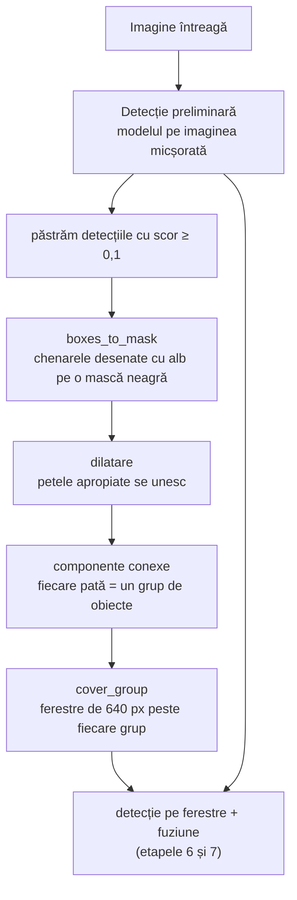

# 9. Ferestrele adaptive

**Cod:** `src/pi_p/adaptive.py`, `adaptive_predict` din `src/pi_p/predict.py` · **Folosire:** `--mode adaptiv` sau `--mode adaptiv+grila`

## De ce e nevoie de etapa asta

Grila fixă rulează modelul pe toată imaginea, inclusiv pe câmpuri, acoperișuri și apă, unde nu e nimic de găsit. Ferestrele adaptive pun ferestre **doar acolo unde par să fie obiecte**, ca să economisească timp.

Întrebarea „unde par să fie obiecte?” primește un răspuns ieftin: ne uităm la detecțiile de pe imaginea micșorată, pe care modelul o procesează oricum.

## Schema



## Pașii, pe un exemplu

Imagine de 1920 × 1080 cu o intersecție în stânga-sus și o parcare în dreapta-jos. Restul e câmp.

**1. Detecția preliminară.** Pe imaginea micșorată la 640 px, modelul găsește o parte dintre mașini, cu scoruri modeste. Nu ne trebuie chenare exacte, doar zona.

**2. Masca.** Desenăm fiecare chenar cu alb pe o imagine neagră de mărimea originalului.

```
┌────────────────────────────────┐
│ ▪▪ ▪                           │
│ ▪ ▪▪                           │
│                                │
│                         ▪ ▪▪   │
│                         ▪▪ ▪   │
└────────────────────────────────┘
```

**3. Dilatarea.** Fiecare pată albă e îngroșată cu 32 px în toate direcțiile. Petele aflate la mai puțin de ~64 px una de alta se ating și devin o singură pată.

```
┌────────────────────────────────┐
│ ██████                         │
│ ██████                         │
│                                │
│                        ██████  │
│                        ██████  │
└────────────────────────────────┘
```

**4. Componentele conexe.** `cv2.connectedComponentsWithStats` numără petele și întoarce dreptunghiul care încadrează fiecare: aici, două grupuri.

**5. Ferestrele.** Peste fiecare grup punem ferestre de exact 640 × 640, mărimea pe care a fost antrenat modelul:

| Grupul | Ferestre |
|---|---|
| încape într-o fereastră | una singură, centrată pe grup |
| e mai mare decât o fereastră | o mică grilă de ferestre suprapuse, doar peste grup |

Ferestrele care ar ieși din imagine sunt împinse înapoi în ea.

**Rezultat:** 2 ferestre în loc de cele 8 ale grilei.

## De unde vine ideea

| Sursă | Ce am preluat | Ce am făcut altfel |
|---|---|---|
| QueryDet (Yang et al., 2022) | căutăm întâi grosier, apoi fin doar în zonele promițătoare | la ei, căutarea grosieră e în interiorul rețelei și se antrenează; la noi e o rulare obișnuită a modelului |
| ClusDet (Yang et al., 2019) | grupăm obiectele în regiuni și analizăm fiecare regiune | la ei, regiunile sunt propuse de o rețea separată; la noi, de dilatare și componente conexe |

Nu antrenăm nimic în plus: metoda funcționează cu orice model deja antrenat.

## Limitele metodei

**Obiectele nevăzute de detecția preliminară nu primesc fereastră.** Un grup de pietoni atât de mici încât pe imaginea micșorată nu apare niciunul rămâne nedetectat. Pentru asta există modul `adaptiv+grila`, în care grila rămâne ca plasă de siguranță. E cel mai lent mod, pentru că rulează ambele seturi de ferestre.

**Dilatarea trebuie reglată.** Prea mică: multe ferestre mici, aproape una pe obiect. Prea mare: un singur grup cât toată imaginea, adică o grilă. Valoarea 32 px este un punct de pornire, nu una optimizată.

**În scene aglomerate nu se câștigă timp.** Dacă obiectele sunt peste tot, grupurile acoperă toată imaginea și ajungem la la fel de multe ferestre ca la grilă. Pe val chiar asta se întâmplă: în medie ies 5,5 ferestre adaptive față de 5,2 de grilă, și doar în 32% dintre imagini sunt mai puține decât la grilă.

## Parametri

Sunt constante în `src/pi_p/predict.py`:

| Constantă | Valoare | Rol |
|---|---|---|
| `QUERY_CONF` | 0,1 | scorul minim al unei detecții preliminare ca să conteze |
| `DILATE` | 32 | raza dilatării, în pixeli ai imaginii întregi |

## Comenzi

```bash
uv run pi-eval best.pt --mode adaptiv
uv run pi-eval best.pt --mode adaptiv+grila
uv run pi-predict best.pt imagine.jpg --slice 640 --windows adaptiv
```

Ce a ieșit la măsurători este în [../rezultate.md](../rezultate.md).
