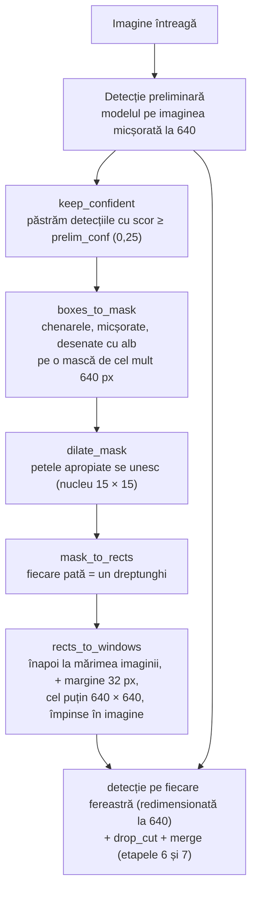

# 9. Ferestrele adaptive

**Cod:** `src/pi_p/adaptive.py` · **Parametri:** `configs/adaptive.yaml` · **Folosire:** `pi-eval --mode adaptive`

## De ce e nevoie de etapa asta

Grila fixă rulează modelul pe toată imaginea, inclusiv pe câmpuri, acoperișuri și apă, unde nu e nimic de găsit. Ferestrele adaptive pun ferestre **doar acolo unde par să fie obiecte**.

Întrebarea „unde par să fie obiecte?” primește un răspuns ieftin: ne uităm la detecțiile de pe imaginea micșorată, pe care modelul o procesează oricum.

## Schema



Funcția `adaptive_trace` întoarce și toate etapele intermediare (masca, masca dilatată, dreptunghiurile, ferestrele). Din ele, `adaptive_figure.py` desenează figura pas cu pas a metodei.

## Pașii, pe un exemplu

Imagine de 1920 × 1080 cu o intersecție în stânga-sus și o parcare în dreapta-jos. Restul e câmp.

**1. Detecția preliminară.** Pe imaginea micșorată la 640 px, modelul găsește o parte dintre mașini. Păstrăm doar detecțiile cu scor de cel puțin 0,25. Nu ne trebuie chenare exacte, doar zona.

**2. Masca.** Masca se face la o rezoluție mică, de cel mult `mask_size = 640` px pe latura mare (aici 640 × 360, adică de 3 ori mai mică). Chenarele sunt micșorate la fel și desenate cu alb pe fundal negru. Pe o mască mică, dilatarea și căutarea petelor sunt rapide.

```
┌────────────────────────────────┐
│ ▪▪ ▪                           │
│ ▪ ▪▪                           │
│                                │
│                         ▪ ▪▪   │
│                         ▪▪ ▪   │
└────────────────────────────────┘
```

**3. Dilatarea.** Fiecare pată albă e îngroșată cu un nucleu de 15 × 15 pixeli de mască, adică 7 pixeli în fiecare direcție, cam 21 de pixeli ai imaginii întregi la exemplul nostru. Petele apropiate se ating și devin una singură. Nucleul trebuie să aibă latura impară, ca să aibă un pixel central și masca să crească la fel în toate direcțiile.

```
┌────────────────────────────────┐
│ ██████                         │
│ ██████                         │
│                                │
│                        ██████  │
│                        ██████  │
└────────────────────────────────┘
```

**4. Dreptunghiurile.** `cv2.connectedComponentsWithStats` numără petele și întoarce dreptunghiul care încadrează fiecare: aici, două.

**5. Ferestrele.** Fiecare dreptunghi devine o fereastră:

| Pas | Ce face |
|---|---|
| `scale_rects` | readuce dreptunghiul la mărimea imaginii întregi (× 3) |
| `grow_rects` | adaugă o margine de 32 px pe fiecare latură, ca obiectele de pe margine să nu fie tăiate |
| `enforce_min_size` | dacă e mai mic de 640 × 640, îl lărgește în jurul centrului |
| `fit_in_image` | dacă iese din imagine, îl împinge înapoi în ea |

Fereastra poate fi deci **mai mare** de 640 px, dacă grupul e mare. Înainte de detecție, ea e redimensionată la 640 (`window_imgsz`), deci o fereastră mare e văzută la o rezoluție mai mică decât cea reală.

**Rezultat:** 2 ferestre în loc de cele 8 ale grilei.

## De unde vine ideea

| Sursă | Ce am preluat | Ce am făcut altfel |
|---|---|---|
| QueryDet (Yang et al., 2022) | căutăm întâi grosier, apoi fin doar în zonele promițătoare | la ei, căutarea grosieră e în interiorul rețelei și se antrenează; la noi e o rulare obișnuită a modelului |
| ClusDet (Yang et al., 2019) | grupăm obiectele în regiuni și analizăm fiecare regiune | la ei, regiunile sunt propuse de o rețea separată; la noi, de dilatare și componente conexe |

Nu antrenăm nimic în plus: metoda funcționează cu orice model deja antrenat.

## Limitele metodei

**Obiectele nevăzute de detecția preliminară nu primesc fereastră.** Un grup de pietoni atât de mici încât pe imaginea micșorată nu apare niciunul rămâne nedetectat. O variantă în care grila rămâne ca plasă de siguranță, pe lângă ferestrele adaptive, a fost măsurată (vezi rezultatele), dar nu există încă în `pi-eval`.

**Grupurile mici tot primesc o fereastră întreagă.** O singură mașină izolată primește o fereastră de 640 × 640. Într-o scenă cu multe grupuri mici, ferestrele se suprapun mult: pe val ies în medie 10,2 ferestre pe imagine, care acoperă împreună de 4,5 ori suprafața imaginii.

**Grupurile mari sunt văzute la rezoluție mai mică.** O fereastră de 1200 px e redimensionată la 640, deci obiectele din ea apar mai mici decât în grilă.

**Parametrii trebuie reglați.** Un nucleu de dilatare mai mare unește mai multe grupuri, deci dă mai puține ferestre, dar mai mari. Un prag preliminar mai mare dă mai puține grupuri, dar ratează mai multe obiecte. Valorile din `configs/adaptive.yaml` sunt un punct de pornire, nu unele optimizate.

## Parametri

Sunt în `configs/adaptive.yaml` și se pot schimba din linia de comandă, scriind `cheie=valoare` imediat după ponderi. Pragul `conf` e luat de `pi-eval` din `--conf`, ca toate modurile să fie comparate cu același prag.

| Parametru | Valoare | Rol |
|---|---|---|
| `mask_size` | 640 | latura mare a măștii, în pixeli |
| `dilate_kernel` | 15 | latura nucleului de dilatare, în pixeli ai măștii (impară) |
| `margin` | 32 | marginea adăugată ferestrei, în pixeli ai imaginii |
| `min_size` | 640 | latura minimă a unei ferestre |
| `prelim_imgsz` | 640 | rezoluția detecției preliminare |
| `prelim_conf` | 0,25 | scorul minim al unei detecții preliminare ca să primească fereastră |
| `window_imgsz` | 640 | rezoluția la care e rulat modelul pe fiecare fereastră |
| `conf` | 0,25 | pragul de încredere al detecțiilor finale |
| `iou` | 0,5 | pragul de suprapunere la eliminarea dublurilor |

## Comenzi

```bash
# în aceleași condiții ca celelalte moduri (imagini întregi, prag 0,001)
uv run pi-eval weights/yolo26n_tiled.pt --mode adaptive

# cu parametri schimbați
uv run pi-eval weights/yolo26n_tiled.pt dilate_kernel=31 min_size=480 --mode adaptive --out logs/eval/adaptiv_k31.json

# figurile cu pașii metodei
uv run python -m pi_p.adaptive_figure --help
```

Ce a ieșit la măsurători este în [../rezultate.md](../rezultate.md).
