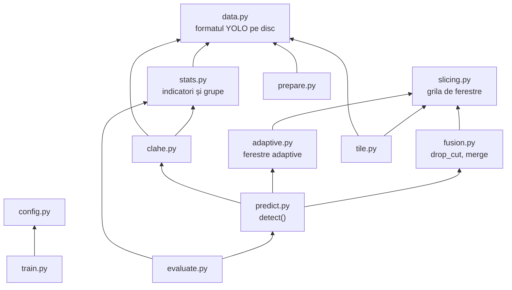

# Pipeline-ul proiectului, pas cu pas

Acest folder explică fiecare etapă a proiectului: ce problemă rezolvă, cum funcționează, unde e codul și cu ce comandă se rulează. Fiecare etapă are fișierul ei. Citite în ordine, ele urmează drumul unei imagini de la descărcare până la tabelul de rezultate.

## Imaginea de ansamblu

Proiectul are două părți care se întâlnesc la model:

- **pregătirea și antrenarea** se fac o singură dată și produc un fișier de greutăți (`best.pt`);
- **detecția și evaluarea** folosesc acel fișier pe imagini noi.


## Etapele

| Nr. | Etapa | Ce face, pe scurt | Cod | Comandă |
|---|---|---|---|---|
| 1 | [Pregătirea datelor](01-pregatirea-datelor.md) | descarcă VisDrone, îl convertește în format YOLO, îl verifică | `prepare.py`, `check.py`, `eda.py` | `pi-prepare`, `pi-check`, `pi-eda` |
| 2 | [Analiza statistică](02-analiza-statistica.md) | măsoară luminozitatea și contrastul, împarte imaginile pe grupe | `stats.py` | `pi-stats` |
| 3 | [Îmbunătățirea contrastului](03-imbunatatirea-contrastului.md) | aplică CLAHE, pe toate imaginile sau doar pe cele care îl cer | `clahe.py` | `pi-clahe` |
| 4 | [Felierea pe grilă](04-felierea-pe-grila.md) | taie imaginea în ferestre suprapuse de 640 px | `slicing.py`, `tile.py` | `pi-tile` |
| 5 | [Antrenarea](05-antrenarea.md) | fine-tuning YOLO26n pe imagini întregi sau pe felii | `train.py`, `config.py` | `pi-train` |
| 6 | [Detecția pe ferestre](06-detectia-pe-ferestre.md) | rulează modelul pe fiecare fereastră și mută chenarele în imaginea întreagă | `predict.py` | `pi-predict` |
| 7 | [Fuziunea detecțiilor](07-fuziunea-detectiilor.md) | elimină obiectele tăiate și dublurile dintre ferestre | `fusion.py` | (parte din 6) |
| 8 | [Evaluarea](08-evaluarea.md) | compară detecțiile cu etichetele și calculează mAP | `evaluate.py` | `pi-eval` |
| 9 | [Ferestrele adaptive](09-ferestre-adaptive.md) | pune ferestre doar unde sunt obiecte | `adaptive.py` | `--mode adaptiv` |

Rezultatele măsurate până acum sunt în [../rezultate.md](../rezultate.md), iar planul experimentelor în [../benchmarkuri.md](../benchmarkuri.md).

## Cum depind modulele unele de altele

Săgeata înseamnă „folosește”. Modulele de jos nu știu nimic despre cele de sus, deci pot fi citite și testate separat.



Două module din `src/pi_p/` nu apar în schemă pentru că țin de aplicația web, nu de pipeline: `analytics.py` (statistici de trafic) și `scoremap.py` (harta de scoruri a detectorului). Serverul și dashboard-ul sunt în `infrastructure/` și sunt descrise în [../uml.md](../uml.md).

## Toate comenzile, în ordine

```bash
uv sync                                   # instalează dependențele

# 1. date
uv run pi-prepare                         # descarcă și convertește VisDrone
uv run pi-check                           # verifică setul de date
uv run pi-eda                             # grafice despre obiecte

# 2. grupe de iluminare
uv run pi-stats

# etapa 1 din plan: imagini întregi vs. felii
uv run pi-train configs/train.yaml        # baseline
uv run pi-tile                            # felii pentru antrenare
uv run pi-train configs/train_tiled.yaml  # model pe felii

# evaluare, mereu pe imaginile întregi din val
uv run pi-eval runs/detect/runs/yolo26n_640/weights/best.pt --mode intreg
uv run pi-eval runs/detect/runs/yolo26n_640/weights/best.pt --mode grila
uv run pi-eval runs/detect/runs/yolo26n_tiled/weights/best.pt --mode grila

# etapa 2 din plan: CLAHE (cere reantrenare)
uv run pi-clahe uniform
uv run pi-tile --src datasets/VisDrone-clahe-uniform --dst datasets/VisDrone-clahe-uniform-tiled
uv run pi-train configs/train_tiled.yaml data=datasets/VisDrone-clahe-uniform-tiled/data.yaml name=yolo26n_tiled_clahe_uniform
uv run pi-eval runs/detect/runs/yolo26n_tiled_clahe_uniform/weights/best.pt --mode grila --data datasets/VisDrone-clahe-uniform/data.yaml

# etapa 3 din plan: ferestre adaptive (fără reantrenare)
uv run pi-eval runs/detect/runs/yolo26n_tiled/weights/best.pt --mode adaptiv
uv run pi-eval runs/detect/runs/yolo26n_tiled/weights/best.pt --mode adaptiv+grila
```

## Testele

Fiecare etapă are teste în `tests/`, care rulează fără date reale și fără placă video:

```bash
uv run pytest
```

| Fișier de test | Ce verifică |
|---|---|
| `test_prepare.py` | conversia adnotărilor și acoperirea regiunilor ignorate |
| `test_check_tile.py` | verificarea setului de date și felierea pentru antrenare |
| `test_stats_clahe.py` | indicatorii, grupele, pragurile și CLAHE |
| `test_slicing.py` | grila de ferestre, `drop_cut` și `merge` |
| `test_adaptive.py` | gruparea obiectelor și ferestrele adaptive |
| `test_evaluate.py` | potrivirea detecțiilor și calculul mAP |
