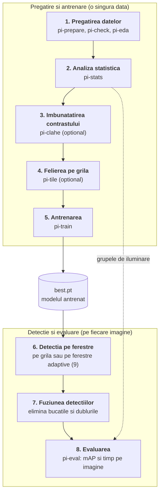
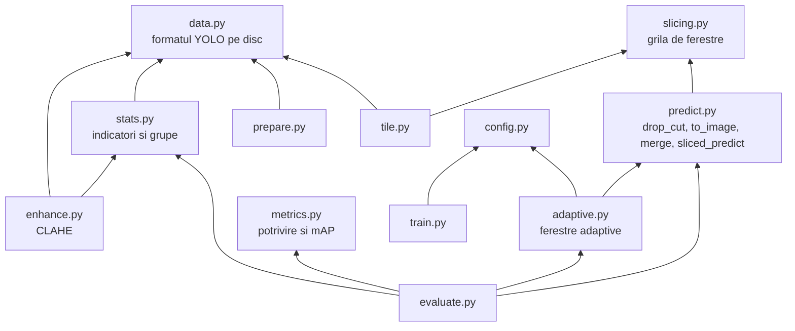

# Pipeline-ul proiectului, pas cu pas

Acest folder explica fiecare etapa a proiectului: ce problema rezolva, cum functioneaza, unde e codul si cu ce comanda se ruleaza. Fiecare etapa are fisierul ei. Citite in ordine, ele urmeaza drumul unei imagini de la descarcare pana la tabelul de rezultate.

## Imaginea de ansamblu

Proiectul are doua parti care se intalnesc la model:

- **pregatirea si antrenarea** se fac o singura data si produc un fisier de greutati (`best.pt`);
- **detectia si evaluarea** folosesc acel fisier pe imagini noi.



## Etapele

| Nr. | Etapa | Ce face, pe scurt | Cod | Comanda |
|---|---|---|---|---|
| 1 | [Pregatirea datelor](01-pregatirea-datelor.md) | descarca VisDrone, il converteste in format YOLO, il verifica | `prepare.py`, `check.py`, `eda.py` | `pi-prepare`, `pi-check`, `pi-eda` |
| 2 | [Analiza statistica](02-analiza-statistica.md) | masoara luminozitatea si contrastul, imparte imaginile pe grupe | `stats.py` | `pi-stats` |
| 3 | [Imbunatatirea contrastului](03-imbunatatirea-contrastului.md) | aplica CLAHE, pe toate imaginile sau doar pe cele care il cer | `enhance.py` | `pi-clahe` |
| 4 | [Felierea pe grila](04-felierea-pe-grila.md) | taie imaginea in ferestre suprapuse de 640 px | `slicing.py`, `tile.py` | `pi-tile` |
| 5 | [Antrenarea](05-antrenarea.md) | fine-tuning YOLO26n pe imagini intregi sau pe felii | `train.py`, `config.py` | `pi-train` |
| 6 | [Detectia pe ferestre](06-detectia-pe-ferestre.md) | ruleaza modelul pe fiecare fereastra si muta chenarele in imaginea intreaga | `predict.py` | `pi-predict` |
| 7 | [Fuziunea detectiilor](07-fuziunea-detectiilor.md) | elimina obiectele taiate si dublurile dintre ferestre | `predict.py` | (parte din 6) |
| 8 | [Evaluarea](08-evaluarea.md) | compara detectiile cu etichetele si calculeaza mAP | `evaluate.py`, `metrics.py` | `pi-eval` |
| 9 | [Ferestrele adaptive](09-ferestre-adaptive.md) | pune ferestre doar unde sunt obiecte | `adaptive.py` | `pi-eval --mode adaptive` |

Rezultatele masurate pana acum sunt in [../rezultate.md](../rezultate.md), iar planul experimentelor in [../benchmarkuri.md](../benchmarkuri.md). Un rezumat pe o singura pagina, cu legatura dintre comenzi, este in [../pipeline.md](../pipeline.md), iar codul explicat functie cu functie in [../cod.md](../cod.md).

## Cum depind modulele unele de altele

Sageata inseamna „foloseste”. Modulele de jos nu stiu nimic despre cele de sus, deci pot fi citite si testate separat.



Doua module din `src/pi_p/` nu apar in schema pentru ca tin de aplicatia web, nu de pipeline: `analytics.py` (statistici de trafic) si `scoremap.py` (harta de scoruri a detectorului). Serverul si dashboard-ul sunt in `infrastructure/` si sunt descrise in [../uml.md](../uml.md).

## Toate comenzile, in ordine

```bash
uv sync                                   # instaleaza dependentele

# 1. date
uv run pi-prepare                         # descarca si converteste VisDrone
uv run pi-check                           # verifica setul de date
uv run pi-eda                             # grafice despre obiecte

# 2. grupe de iluminare
uv run pi-stats

# etapa 1 din plan: imagini intregi vs. felii
uv run pi-train configs/train.yaml        # baseline
uv run pi-tile                            # felii pentru antrenare
uv run pi-train configs/train_tiled.yaml  # model pe felii

# evaluare, mereu pe imaginile intregi din val
G="--groups datasets/VisDrone/stats.csv"
uv run pi-eval weights/yolo26n_baseline_640.pt --mode full  $G
uv run pi-eval weights/yolo26n_baseline_640.pt --mode slice $G
uv run pi-eval weights/yolo26n_baseline_640.pt --mode sahi  $G
uv run pi-eval weights/yolo26n_tiled.pt        --mode slice $G

# etapa 2 din plan: CLAHE (cere reantrenare)
uv run pi-clahe --mode uniform
uv run pi-tile --src datasets/VisDrone-clahe --dst datasets/VisDrone-clahe-tiled
uv run pi-train configs/train_tiled.yaml data=datasets/VisDrone-clahe-tiled/data.yaml name=yolo26n_tiled_clahe_uniform
uv run pi-eval runs/yolo26n_tiled_clahe_uniform/weights/best.pt --mode slice --data datasets/VisDrone-clahe/data.yaml $G

# etapa 3 din plan: ferestre adaptive (fara reantrenare)
uv run pi-eval weights/yolo26n_tiled.pt --mode adaptive $G
```

## Testele

Fiecare etapa are teste in `tests/`, care ruleaza fara date reale si fara placa video:

```bash
uv run pytest
```

| Fisier de test | Ce verifica |
|---|---|
| `test_prepare.py` | conversia adnotarilor si acoperirea regiunilor ignorate |
| `test_check_tile.py` | verificarea setului de date si felierea pentru antrenare |
| `test_enhance.py` | indicatorii, grupele si CLAHE |
| `test_slicing.py` | grila de ferestre, `drop_cut` si `merge` |
| `test_adaptive.py` | gruparea obiectelor si ferestrele adaptive |
| `test_metrics.py` | potrivirea detectiilor si calculul mAP |
| `test_evaluate.py` | evaluatorul, pe toate modurile si pe grupe |
| `test_adaptive_figure.py` | figurile ferestrelor adaptive |
