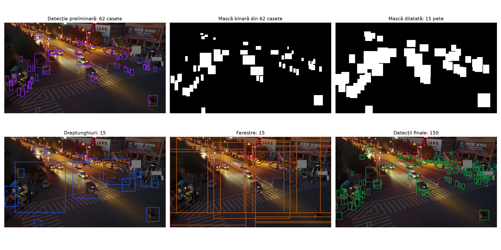
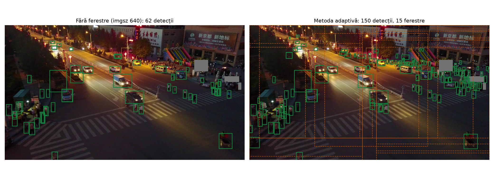

# Rezultate

Toate valorile sunt măsurate cu `pi-eval` pe cele 548 de imagini întregi din **val**, cu prag de încredere 0,001 și grupele din `datasets/VisDrone/stats.csv`. Cum se calculează fiecare coloană este explicat în [pipeline/08-evaluarea.md](pipeline/08-evaluarea.md). Subsetul test-dev nu a fost rulat încă: el se rulează o singură dată, după ce toate deciziile sunt luate.

## Starea experimentelor

| Etapa din [plan](benchmarkuri.md) | Stare |
|---|---|
| 1. Împărțirea imaginii | **făcută** cu antrenări complete (RTX); SAHI măsurat doar pe modelul de pe Mac |
| 2. CLAHE | **făcută** pe val (ambele variante reantrenate și evaluate); rămâne de verificat pe test |
| 3. Ferestre adaptive | măsurate pe ambele modele; reglarea parametrilor e începută (pe Mac) |
| Test final pe test-dev | nefăcut |

## Antrenările complete (RTX 4070 SUPER)

| Model | Configurare | Date de antrenare | Epoci | Durată | Ponderi |
|---|---|---|---|---|---|
| baseline | `configs/train.yaml` | 6471 imagini întregi | 97 (oprit de `patience`), cea mai bună: 77 | 1,2 ore | `weights/yolo26n_baseline_640.pt` |
| pe felii | `configs/train_tiled.yaml` | 46 483 felii și imagini întregi | 100, cea mai bună: 82 | 7,7 ore | `weights/yolo26n_tiled.pt` |
| pe felii + CLAHE uniform | `configs/train_tiled.yaml` pe date cu CLAHE | idem, după CLAHE pe toate imaginile | 100 | ~7,7 ore | `weights/yolo26n_tiled_clahe_uniform.pt` |
| pe felii + CLAHE adaptiv | `configs/train_tiled.yaml` pe date cu CLAHE | idem, după CLAHE doar pe imaginile `dark` și `low_contrast` | 100, cea mai bună: 79 | ~8 ore (oprită o dată și reluată) | `weights/yolo26n_tiled_clahe_adaptiv.pt` |

Seturile CLAHE ale acestor antrenări au fost făcute cu o versiune anterioară a `pi-clahe`, cu pragurile de grupă calculate ca percentila 15 pe train (luminozitate 61,6, contrast 36,0), nu cu pragurile fixe 70 și 35 din codul actual. Pentru CLAHE uniform nu contează, pentru că acolo toate imaginile primesc CLAHE. Pentru CLAHE adaptiv contează: setul de imagini îmbunătățite diferă puțin de cel pe care l-ar alege codul actual.

### Etapa 1: cum împărțim imaginea

| Variantă | Antrenare | `--mode` | mAP50 | mAP50-95 | ms/imagine* |
|---|---|---|---|---|---|
| Baseline | imagini întregi | `full` | 0,307 | 0,173 | 16 |
| Baseline + grilă | imagini întregi | `slice` | 0,392 | 0,223 | 69 |
| Model pe felii, imagine întreagă | felii | `full` | 0,327 | 0,189 | 17 |
| **Model pe felii + grilă** | felii | `slice` | **0,483** | **0,292** | 60 |
| Model pe felii + ferestre adaptive | felii | `adaptive` | 0,502 | 0,304 | 170 |

\* Măsurat în timp ce placa video rula o altă antrenare, deci timpii absoluți sunt umflați; contează doar comparația dintre rânduri. Cu placa liberă, `full` dădea ~8–10 ms, iar `slice` ~35–45 ms.

Ce arată tabelul:

- **Felierea la testare ajută și fără reantrenare:** +0,085 mAP50 (rândul 2 față de rândul 1).
- **Antrenarea pe felii adaugă încă +0,091** peste asta (rândul 4 față de rândul 2).
- **Antrenarea pe felii, singură, ajută puțin:** +0,020 (rândul 3 față de rândul 1). Câștigul vine din combinația „antrenat pe felii, testat pe felii”.
- **Costul este timpul:** grila e de aproximativ 4 ori mai lentă decât imaginea întreagă.

Configurația selectată pentru etapele următoare: **model pe felii + grilă**.

### Pe clase (mAP50-95)

| Clasă | Baseline (`full`) | Model pe felii + grilă | Diferență |
|---|---|---|---|
| pedestrian | 0,154 | 0,289 | +0,135 |
| people | 0,092 | 0,182 | +0,090 |
| bicycle | 0,031 | 0,138 | +0,107 |
| car | 0,495 | 0,602 | +0,107 |
| van | 0,202 | 0,329 | +0,127 |
| truck | 0,175 | 0,298 | +0,123 |
| tricycle | 0,110 | 0,211 | +0,101 |
| awning-tricycle | 0,044 | 0,103 | +0,059 |
| bus | 0,274 | 0,477 | +0,203 |
| motor | 0,159 | 0,293 | +0,134 |

Toate clasele cresc. Bicycle crește de aproximativ 4,5 ori, iar pedestrian aproape se dublează. Creșterea la clasele cu obiecte mici este în acord cu ipoteza de la care a pornit felierea; nu am măsurat însă separat pe mărimi de obiecte, deci nu putem spune cât din câștig vine de la ele.

### Pe grupe de iluminare (mAP50)

Grupele sunt calculate de `pi-stats` cu pragurile 70 și 35:

| Subset | dark | low_contrast | normal |
|---|---|---|---|
| val | 13 | 104 | 431 |
| test | 501 | 77 | 1032 |

| Variantă | dark (13) | low_contrast (104) | normal (431) |
|---|---|---|---|
| Baseline (`full`) | 0,401 | 0,307 | 0,303 |
| Baseline + grilă | 0,448 | 0,370 | 0,391 |
| Model pe felii + grilă | 0,573 | 0,503 | 0,479 |
| Model pe felii + adaptive | 0,565 | 0,524 | 0,498 |

**Val are doar 13 imagini întunecate.** Un mAP calculat pe 13 imagini se schimbă mult de la o imagine la alta, deci coloana `dark` nu poate susține nicio concluzie. Pentru etapa 2 (CLAHE), asta e o problemă reală: efectul pe imaginile de noapte se va vedea bine abia pe test, care are 501.

Imaginile cu contrast slab nu ies mai prost decât cele normale. Asta nu înseamnă că iluminarea slabă ajută: grupele diferă și prin scenă și prin numărul de obiecte.

### Etapa 2: CLAHE

Fiecare model CLAHE este evaluat pe val cu același CLAHE aplicat (`VisDrone-clahe-uniform`, respectiv `VisDrone-clahe-adaptiv`), iar grupele sunt cele din `datasets/VisDrone/stats.csv`, calculate pe imaginile originale.

| Model (`slice`) | mAP50 | mAP50-95 | dark (13) | low_contrast (104) | normal (431) |
|---|---|---|---|---|---|
| pe felii, fără CLAHE | 0,483 | 0,292 | 0,573 | 0,503 | 0,479 |
| pe felii + CLAHE uniform | 0,482 | 0,289 | 0,571 | 0,494 | 0,480 |
| pe felii + CLAHE adaptiv | 0,484 | 0,292 | 0,562 | 0,468 | 0,483 |

Cu imaginea întreagă (`full`), cele trei modele dau mAP50 0,327, 0,325 și 0,326.

Ce arată tabelul:

- **Pe val, CLAHE nu schimbă rezultatul.** Diferențele pe tot setul sunt de cel mult 0,002, adică în zgomotul dintre două antrenări.
- **Pe imaginile slab contrastate, CLAHE adaptiv iese chiar mai prost** (0,468 față de 0,503), deși acolo ar fi trebuit să ajute. Pe 104 imagini, diferența poate fi și întâmplătoare.
- **Grupa `dark` are doar 13 imagini**, deci nu spune nimic. Efectul pe imaginile de noapte se poate măsura doar pe test, care are 501.

Configurația selectată rămâne **model pe felii + grilă, fără CLAHE**; CLAHE adaptiv va fi verificat o dată pe test, la final, pentru grupa `dark`.

### Ferestre adaptive pe modelul pe felii

Cu parametrii impliciți din `configs/adaptive.yaml`: mAP50 0,502, față de 0,483 la grilă (+0,019), dar cu 10,2 ferestre pe imagine, care acoperă împreună de 4,5 ori suprafața imaginii, deci aproape de 3 ori mai lent. Aceeași concluzie ca pe modelul de pe Mac de mai jos: metoda adaptivă detectează puțin mai bine, dar nu economisește timp fără reglarea parametrilor.

O variantă anterioară a ferestrelor adaptive, cu ferestre fixe de 640 px puse peste fiecare grup, a dat pe același model mAP50 0,490 cu 5,5 ferestre pe imagine, iar varianta „adaptive + grilă” 0,507. Ambele au fost scoase din cod la unirea cu `main`; valorile sunt păstrate aici pentru comparație.

### Cum reproduci tabelele

```bash
G="--groups datasets/VisDrone/stats.csv"
uv run pi-stats
uv run pi-eval weights/yolo26n_baseline_640.pt --mode full     $G --out logs/eval/baseline_full.json
uv run pi-eval weights/yolo26n_baseline_640.pt --mode slice    $G --out logs/eval/baseline_slice.json
uv run pi-eval weights/yolo26n_tiled.pt        --mode full     $G --out logs/eval/tiled_full.json
uv run pi-eval weights/yolo26n_tiled.pt        --mode slice    $G --out logs/eval/tiled_slice.json
uv run pi-eval weights/yolo26n_tiled.pt        --mode adaptive $G --out logs/eval/tiled_adaptive.json
uv run pi-eval weights/yolo26n_tiled_clahe_uniform.pt --mode slice --data datasets/VisDrone-clahe-uniform/data.yaml $G
uv run pi-eval weights/yolo26n_tiled_clahe_adaptiv.pt --mode slice --data datasets/VisDrone-clahe-adaptiv/data.yaml $G
```

## Preliminar: modelul antrenat pe Mac (10 epoci)

Model: YOLO26n, 10 epoci pe `train`, imagini întregi de 640 px (`runs/yolo26n_mac`). Evaluare pe `val` (548 de imagini), pe imaginea întreagă, cu `pi-eval`, prag `conf 0.001`. Rezultatele complete sunt în `results/mac_*.json`.

Sunt rezultate preliminare: modelul e antrenat de 10 ori mai puțin decât cel din metodologie, iar varianta „grilă fixă” folosește tot modelul pe imagini întregi, nu cel antrenat pe felii.

| Variantă | `--mode` | mAP50-95 | mAP50 | ms / imagine (Mac, MPS) | Pixeli procesați |
|---|---|---|---|---|---|
| Baseline | `full` | 0.113 | 0.202 | 10 | 1.00x |
| Grilă fixă | `slice` | 0.174 | 0.305 | 60 | ≈3.4x |
| SAHI | `sahi` | 0.166 | 0.298 | 103 | ≈3.4x |
| Ferestre adaptive | `adaptive` | **0.185** | **0.327** | 154 | 5.66x |

mAP50 pe grupe:

| Variantă | dark (13) | low_contrast (104) | normal (431) |
|---|---|---|---|
| `full` | 0.300 | 0.217 | 0.196 |
| `slice` | 0.398 | 0.299 | 0.304 |
| `sahi` | 0.380 | 0.295 | 0.296 |
| `adaptive` | 0.408 | 0.316 | 0.326 |

### Ce arată

- Felierea crește mAP50 cu aproximativ 50% față de baseline (0.202 → 0.305), confirmând că obiectele mici sunt problema principală.
- Fuziunea proprie (`slice`) iese puțin peste SAHI, cu aceleași ferestre, și e mai rapidă.
- Ferestrele adaptive au cel mai bun mAP, dar cu parametrii din `configs/adaptive.yaml` procesează **mai mulți** pixeli decât grila (în medie 10.5 ferestre de cel puțin 640 px, care se suprapun), deci nu economisesc timp. Câștigul de precizie vine probabil din ferestrele centrate pe grupurile de obiecte. Pentru economie de timp trebuie reglate `dilate_kernel` și `min_size`, ca ferestrele să fie mai puține.
- Grupa `dark` are doar 13 imagini pe val, deci valorile ei nu sunt concludente.

### Reglarea ferestrelor adaptive

Ferestrele adaptive pot fi reglate spre precizie sau spre cost. Toate rândurile sunt pe tot `val`, cu același model:

| Setare | mAP50 | mAP50-95 | ms / imagine | Ferestre / imagine | Pixeli procesați |
|---|---|---|---|---|---|
| grilă fixă (`slice`), referință | 0.305 | 0.174 | 60 | 6 (la 1360×765) | ≈3.4x |
| implicit (`dilate_kernel=15`, `min_size=640`) | **0.327** | **0.185** | 154 | 10.5 | 5.66x |
| `dilate_kernel=31` | 0.305 | 0.171 | 84 | 5.5 | 3.45x |
| `dilate_kernel=31 min_size=480` | 0.301 | 0.168 | 74 | 5.5 | **2.56x** |

- Cu setările implicite, metoda adaptivă bate grila cu 0.02 mAP50, dar procesează mai mulți pixeli.
- Cu ferestre mai puține și mai mici, ajunge la aceeași precizie ca grila cu cu 25% mai puțini pixeli. Timpul rămâne totuși mai mare, pentru că se adaugă detecția preliminară, iar ferestrele de mărimi diferite se procesează mai puțin eficient decât cele egale ale grilei.
- Pe primele 100 de imagini din `val`, `min_size=480` părea să dea mAP50 0.350. Pe tot setul a scăzut la 0.301. Primele 100 de imagini vin din câteva secvențe video, deci nu sunt reprezentative, iar reglajele trebuie verificate pe tot `val`.

### Figuri

Pașii metodei adaptive pe o imagine de noapte din `val` (`0000117_02708_d_0000090.jpg`), cu setările implicite: 62 de casete preliminare, 15 ferestre, 150 de detecții finale.





Pixelii procesați pentru `slice` și `sahi` sunt calculați pentru imaginile de 1360×765 (6 ferestre de 640 px plus imaginea întreagă); evaluatorul îi măsoară direct doar la `adaptive`.
