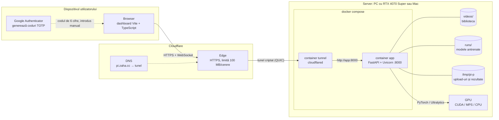
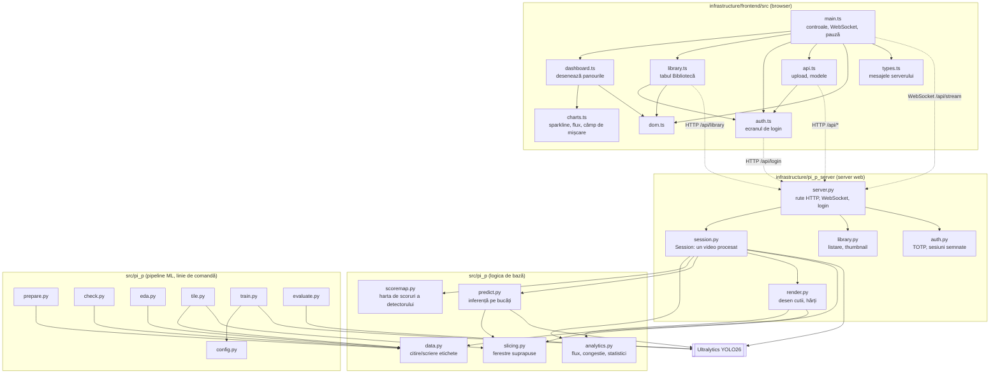
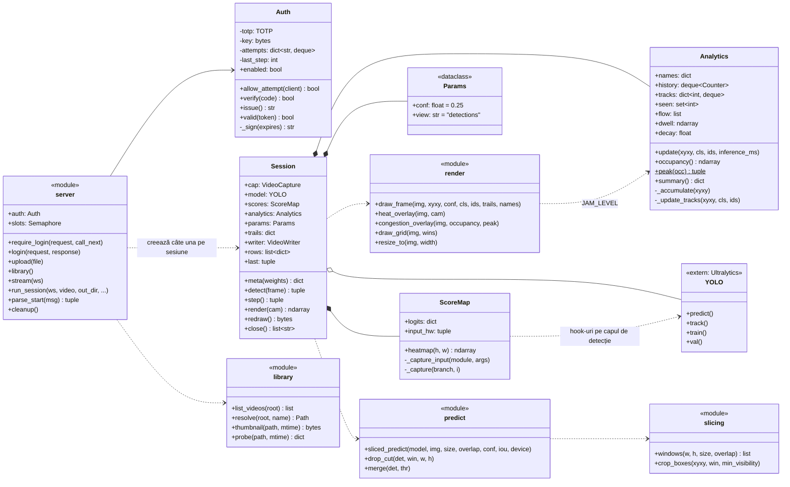
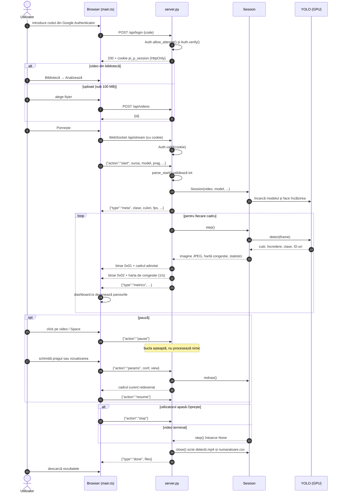
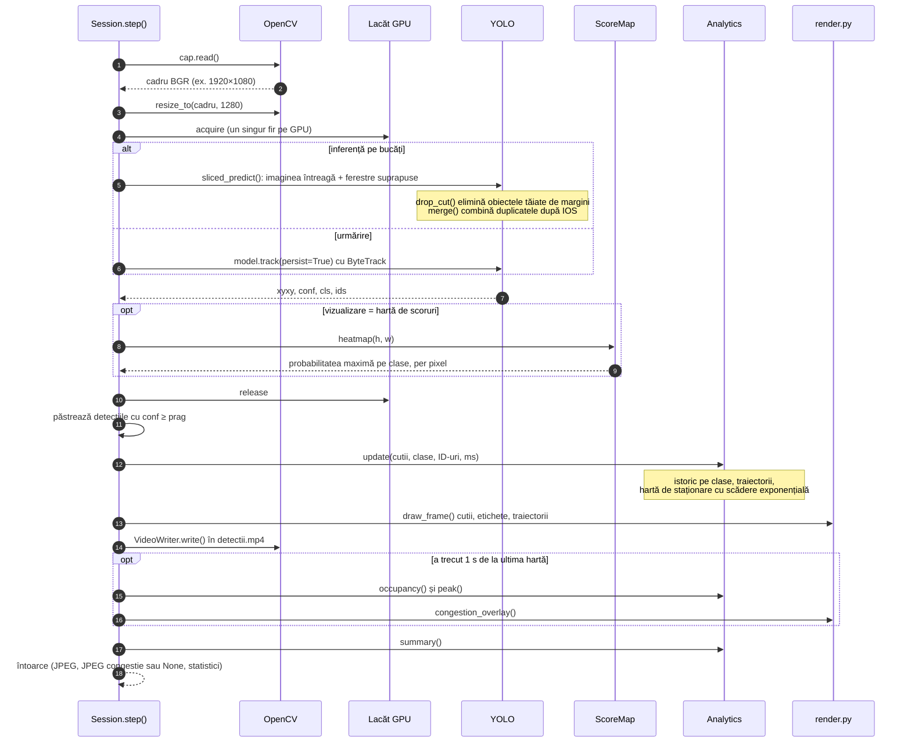
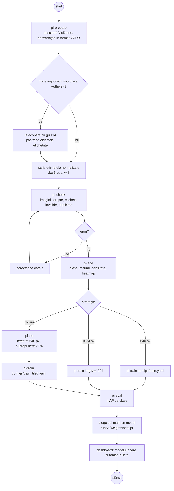
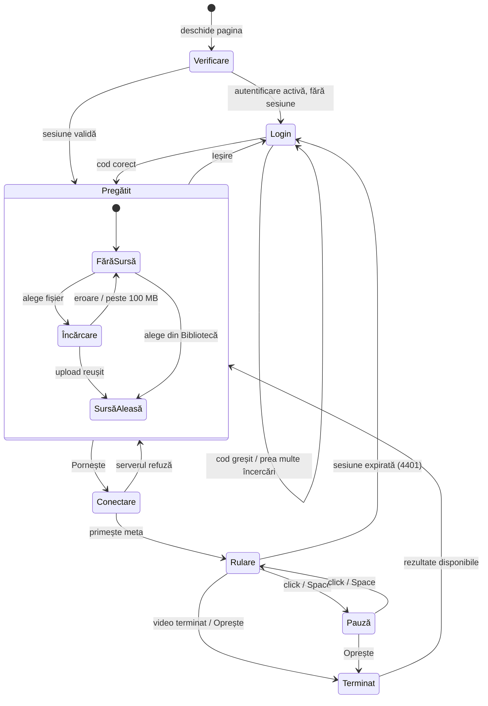

# Arhitectura proiectului (UML)

Diagramele sunt scrise în Mermaid și se afișează direct pe GitHub.

1. [Deployment](#1-diagrama-de-deployment): unde rulează fiecare parte
2. [Componente](#2-diagrama-de-componente): modulele și dependențele dintre ele
3. [Clase](#3-diagrama-de-clase): clasele și funcțiile principale
4. [Secvență: sesiune de analiză](#4-diagrama-de-secvență-sesiune-de-analiză)
5. [Secvență: procesarea unui cadru](#5-diagrama-de-secvență-procesarea-unui-cadru)
6. [Activitate: pipeline-ul de date și antrenare](#6-diagrama-de-activitate-pipeline-ul-de-date-și-antrenare)
7. [Stări: interfața](#7-diagrama-de-stări-interfața)

## 1. Diagrama de deployment

Containerul `app` nu e expus direct în rețea: portul 8000 e legat doar de `127.0.0.1`. Din internet se ajunge numai prin tunel, iar orice cerere `/api/*` cere autentificare.

## 2. Diagrama de componente

## 3. Diagrama de clase

Python nu obligă la clase, așa că modulele formate doar din funcții apar cu stereotipul `«module»`.

## 4. Diagrama de secvență: sesiune de analiză

## 5. Diagrama de secvență: procesarea unui cadru

Ce se întâmplă în `Session.step()` pentru un singur cadru.

## 6. Diagrama de activitate: pipeline-ul de date și antrenare

## 7. Diagrama de stări: interfața

