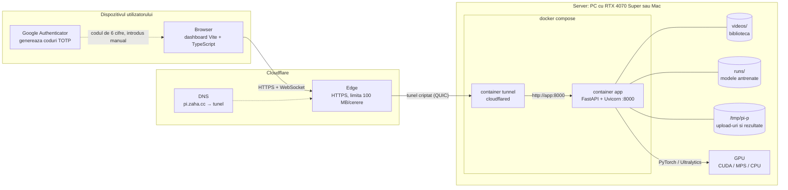
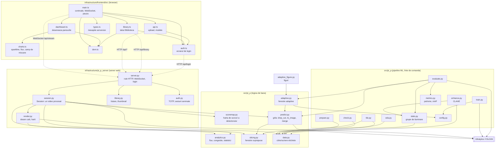
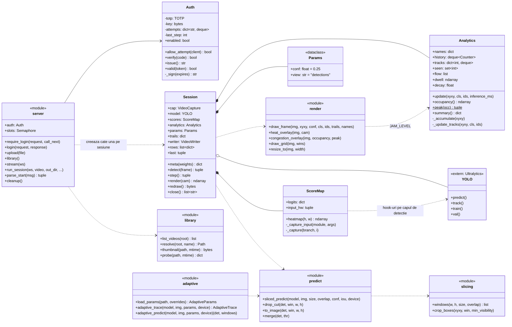
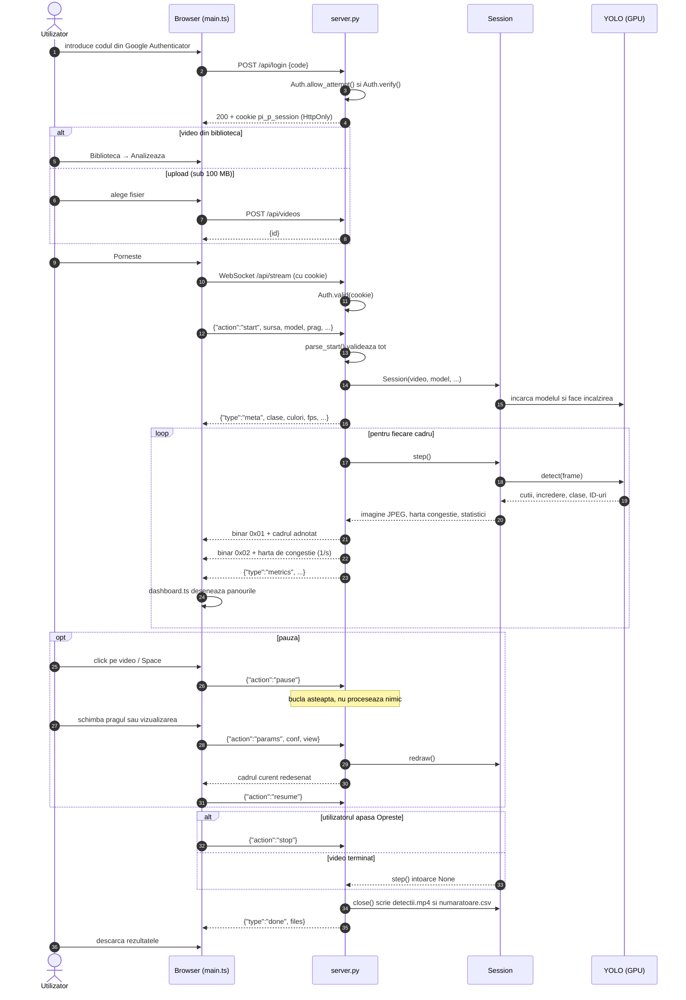
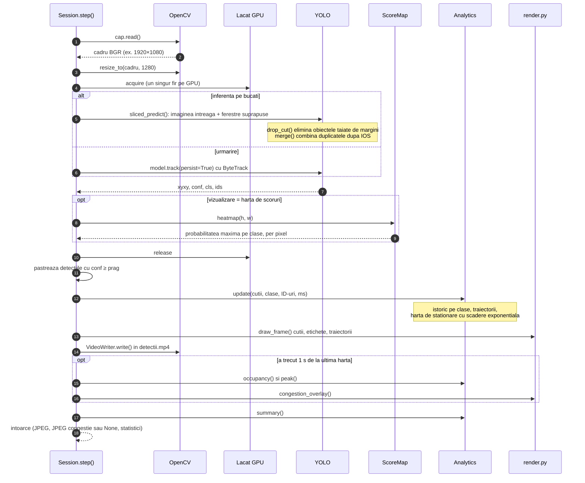
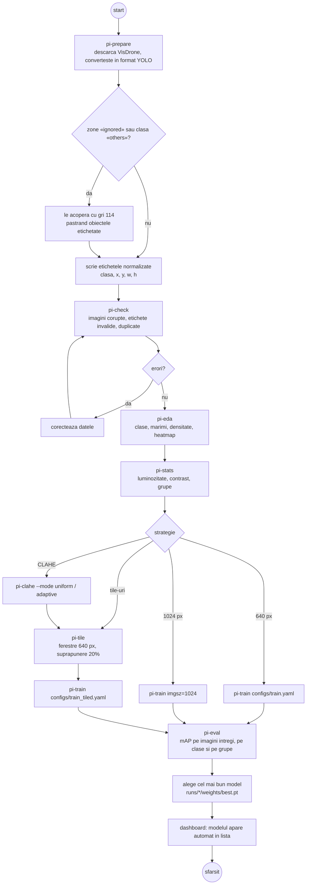
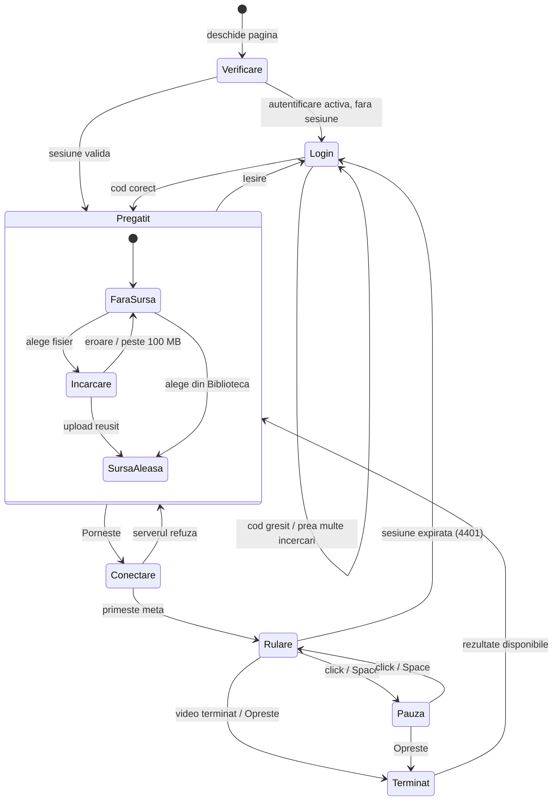

# Arhitectura proiectului (UML)

Diagramele sunt scrise in Mermaid si se afiseaza direct pe GitHub.

1. [Deployment](#1-diagrama-de-deployment): unde ruleaza fiecare parte
2. [Componente](#2-diagrama-de-componente): modulele si dependentele dintre ele
3. [Clase](#3-diagrama-de-clase): clasele si functiile principale
4. [Secventa: sesiune de analiza](#4-diagrama-de-secventa-sesiune-de-analiza)
5. [Secventa: procesarea unui cadru](#5-diagrama-de-secventa-procesarea-unui-cadru)
6. [Activitate: pipeline-ul de date si antrenare](#6-diagrama-de-activitate-pipeline-ul-de-date-si-antrenare)
7. [Stari: interfata](#7-diagrama-de-stari-interfata)

## 1. Diagrama de deployment

Containerul `app` nu e expus direct in retea: portul 8000 e legat doar de `127.0.0.1`. Din internet se ajunge numai prin tunel, iar orice cerere `/api/*` cere autentificare.

## 2. Diagrama de componente

## 3. Diagrama de clase

Python nu obliga la clase, asa ca modulele formate doar din functii apar cu stereotipul `«module»`.

## 4. Diagrama de secventa: sesiune de analiza

## 5. Diagrama de secventa: procesarea unui cadru

Ce se intampla in `Session.step()` pentru un singur cadru.

## 6. Diagrama de activitate: pipeline-ul de date si antrenare

## 7. Diagrama de stari: interfata

